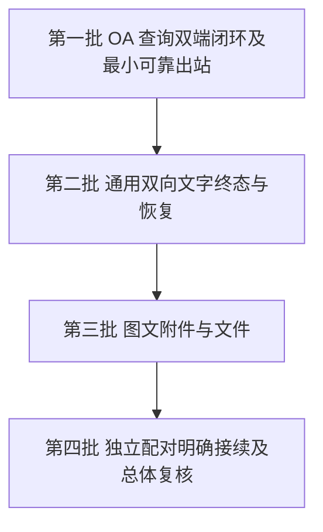

# 工作台与电报同步分批实施方案

日期：2026 年 11 月 27 日。状态：**四批已集成，含原卡关闭修复的候选 `e525ac18b786` 已通过正式 Full 和三个宿主的 SDK 归档校验。生产仍运行 `87765c133e20`，真实桌面与上线验收进度见四批验收记录。**规则见[统一设计](../架构设计/工作台与电报双向同步统一设计.md)，当前证据见[四批实施与验收](../验收记录/工作台与电报同步四批实施与验收-2026-11-27.md)。

实施采用**四批**：① OA 查询双端闭环及本路径最小可靠出站；② 通用双向文字、终态与恢复；③ 图文文件；④ 独立配对迁移与明确接续，含最终复核。首批直接解决原 OA 问题，必要准备归各批内部，不等待通用同步平台全部重构。

用户已明确授权连续完成四批、每批使用 Chrome 扩展与 Telegram 桌面自动验收、三宿主在本任务范围内的必要维护和固定候选渠道交接，以及通过现行门禁后的发布与最终部署。上述范围不逐批重复询问许可；每次操作仍核对实际候选、身份、在途更新、唯一消费者和恢复点，留存可审查记录。真实业务提交、审批、撤销等仍需对应事项授权及既有一次性治理；配对迁移不能用实施授权代替账号本人的身份证明。

本轮真实账号范围已由用户纠正并固定：**第一账号使用真实 Telegram，第二账号只有 Workspace**。所有第二账号隔离检查均在同宿主 Workspace 验证；第二 sender 拒绝可用隔离注入更新证明，但不能写成第二个真实 Telegram 客户端。当前 Pi 私聊开放范围不扩大。

## 一、任务范围与验收目标

用户问题：Workspace 查询 OA 后，OpenClaw Telegram 缺结果文字和卡，NanoBot 缺卡，Pi 样本正常；三个宿主从 Telegram 直接查询正常。需要解释不同入口的差异，梳理双向同步，并统一可交付行为。

调查时确认的原因：OpenClaw 网页快捷查询只有任务结果投影，没有普通助手终答；跨端 OA 结果入口当时仅 Pi；普通镜像与私有卡、终态、附件耦合，三宿主恢复和配对来源不同。四批实施已补来源、持久投递与反向媒体等路径，并取得下述证据。尚未签收的真实链与生产性能分布保持单列；生产运行未知的原始故障不因此被解释为已查明。

预期行为：同一主体在同一实例两个端点能找到原问题、公开终答、当前交互及获准文件；结果来源可追溯；不会多跑模型或业务；同步失败可解释、可安全恢复；旧授权和旧消息不会在迁移或回退中复活。

涉及中央任务/操作/通知/结果视图/配对、Workspace 时间线与状态、OpenClaw 适配器、NanoBot/Pi 共享 Telegram 组件。保留账号隔离、材料期限、可信内容隔离、授权消费、权威核验、未知不重放和既有私聊开放范围。当前批次不扩展微信、不整合模型聊天记录、不顺带调整全局布局或依赖。

执行遵循[开发验证与发布流程](../部署运维/开发验证与发布流程.md)、[开发安全策略](../部署运维/开发安全策略.md)、[发布操作手册](../部署运维/发布操作手册.md)及[苹果系统原生维护](../部署运维/苹果系统原生维护.md)。每批实施前重读现行文件并检查工作区；混有其他改动时使用隔离工作区。

## 二、原始发现清单与证据

证据标记：C＝代码/设计审计；I＝隔离自动化或探针；W＝Chrome 实际 Workspace 页面＋合成下游/模拟 Telegram；T＝固定候选归档＋实际 Chrome/Telegram 桌面＋合成业务；P＝生产只读请求或自然故障只读对账。不同级别不可互相冒充。I 的局部探针不算端到端验收。

下表是实施前发现及当时证据，不表示最终候选仍保留这些缺陷；各项实现和验收结论以文末当前进展及总验收记录为准。

| 发现／场景 | 调查时差距及影响 | 调查时证据 | 责任与批次 |
| --- | --- | --- | --- |
| D01／S01 | 快捷查询无助手镜像，结果卡限 Pi；同一 OA 读取因入口/宿主而出现不同交付 | P＋C | 中央来源与结果投影；1 |
| D02／S02 | error 命名与原 run 关联不符；失败/停止/未知缺独立公开终态 | P＋C；生产仅确认一个未知样本 | OA 查询失败/停止/未知说明 1；通用终态推广 2 |
| D03／S03 | 出现过私有交互会抑制终答；Pi 有专用登录后读取例外 | C | OA 登录续读 1；其他可信交互后的公开内容规则 2 |
| D04／S04 | OpenClaw 用户入站先按短时文字指纹去重，同文新消息可能丢失 | I＋C | 通用双向文字身份 2；首批查询原请求身份 1 |
| D05／S05 | OpenClaw 平台发送回执未持久使用，中央 ACK 丢失后可再次发送 | I＋C；未证明生产重复 | OA 出站发送/回执 1；其余路径推广 2 |
| D06／S06 | 共用 Telegram 传输把明确 429 等归成 unavailable，发送层统一冻结 unknown | I＋C | OA 出站明确拒绝 1；其余路径推广 2 |
| D07／S07 | 部分通知路径在绑定复核前标记 sending，发送前超时被误记 unknown | I＋C；不泛化到所有路径 | OA 发送前复核 1；其余通知/直发推广 2 |
| D08／S08 | 带附件请求被排除普通镜像；反向接口多为文字；Pi 原图路径尚不等于整轮图文对齐 | C | 时间线、媒体、三宿主；3 |
| D09／S09 | 私聊文字超过 50,000 上限可能整条被拒，其他路径采用截断，规则不一致 | C | 首批 OA 答复有界明示 1；通用长答/逐段恢复 2 |
| D10／S10 | OpenClaw 时间线补写只有内存有限重试，进程重启后无法靠持久待发布恢复 | C | OpenClaw 入站账本、中央幂等；2 |
| D11／S11 | 无入队缺解释，静默 ACK 与发送 ACK 混用，管理状态可能误称送达 | P＋C | OA 本路径资格/送达证据 1；通用诊断 2 |
| D12／S12 | NanoBot 配对依赖旧 OpenClaw 身份；独立撤销若无禁止回退标记可能重用旧授权 | P＋C | 首批新增出站启用前最小撤销保护 1；完整配对与迁移 4 |
| D13／S13 | 可见历史与模型上下文不同；OpenClaw 有有限跨端上下文，另两宿主按独立会话运行 | C；产品边界待统一 | 原消息/任务引用与明确接续；4 |
| D14／S14 | NanoBot 媒体完整请求摘要与时间线纯文字摘要不一致，caption 可能无法补写 | I（局部）＋C；完整链未复现 | 入站摘要规范、媒体；3 |

代码入口见[统一设计](../架构设计/工作台与电报双向同步统一设计.md)。本机脱敏调查材料保存于 `/Users/guomao/.local/state/agentbridge/workspace-tg-sync-20261127/`，仅供获准本机查验，不是公开仓库依赖；关键事实已在两份文档中独立说明。后续每批将可公开的候选、断言和结果写入仓库验收记录，敏感原始材料留在受控证据目录。

## 三、实施顺序与依赖

按以下四批连续实施。每批在固定候选上验收，第四批综合复核后统一部署上线。每批内的准备、开发步骤和验收不是额外发布批次；某项发现可拆为本路径与通用推广子项，只有全部相关子项通过才关闭该发现。

候选验收按 1 → 2 → 3 → 4 串行。只读调查、隔离夹具与测试准备可并行；共享文件编辑、同 OA 会话、同 Bot、数据库迁移和发布事务串行。独立测试使用独立 home、数据库、端口、输出和合成账号。每批自身阻塞当批解决，不把首批查询失败说明或可靠发送推迟到第二批，也不把第二批全路径改造塞进首批。

### 第 1 批：OA 查询双端闭环与最小可靠出站

首批目标是用户从三个宿主 Workspace 查询本人 OA 后，在对应 Telegram 私聊看到同源问题、公开结果说明和符合条件的结果卡；失败、停止或结果未知也有明确安全说明。直接 Telegram 查询保持正常。覆盖 D01、D03 的 OA 子项、D02 的查询终态，以及 D05–D07、D09、D11、D12 在新增查询出站上的必要保障。

#### 范围与准备

- 固定普通 message/request＋dispatch 与快捷 command/request 两种原身份。问题、接纳前取消或失败不依赖尚未产生的 run/operation；后续只补原关联，不改变事件身份。
- 复用既有任务、操作、结果视图及通知/本地发送账本。以唯一合格原 OA 读取触发结果投递，不依赖 Pi 名称或模型终答，不补造 run，不重查业务。查询失败/停止/未知说明由原请求及权威状态产生，不从错误消息键猜原运行。
- 先冻结本路径所需字段、协议版本、原配对证明、幂等键、发送许可与回执、错误分类、有效期和有界文本策略；只有确有需要才增加最小结构，按现行迁移门禁执行。完整通用账本、全渠道历史补写和全局诊断在第二批推广，不作为首批无条件前置。
- 对本路径落实发送前当前资格复核、平台回执持久化、ACK 补结算、明确拒绝有界重试和未知不重放；核对实际 SDK/HTTP 请求数，禁止底层隐藏重发。原问题、答复、结果卡分别有可核验的投递证据和不适用原因。
- 新增出站启用前冻结有效 pair proof，落实本路径最小撤销/禁止旧授权回退保护，覆盖会接管该范围的新旧发送入口；不重绑用户或迁移历史，完整独立配对仍在第四批。

#### 验收与交付

三个宿主分别覆盖普通查询/快捷入口（未提供的入口标不适用并测实际路径）、直接成功、首次轮询已终态、登录后原查询完成、空结果、部分/缺失/混合来源、来源变化、过期和无权。完整结果的问题、公开终答和应有结果卡归同次查询，每项首次送达一次；同步和重签不增加 OA 读取。打开原卡核对同批待办与零勾选，真实生产不建立办理准备或消费写授权。

查询失败、停止、接纳未知、业务结果未知与发送未知分别有准确说明；登录字段和授权材料不进普通镜像；较长查询答复采用本路径统一有界策略并明示截断，不整条静默丢弃。对文字与结果卡分别注入 ACK 丢失、明确 429、发送前复核超时、租约过期、重启、换绑/撤权及发送未知，核对原请求不重跑、已确认或未知消息不再发。

本批必须取得 Chrome 扩展页面、固定候选真实 Telegram 桌面、原查询和独立发送回执的完整关联；两个端点分别各查一次不能替代同条跨端证据。本批固定候选双端验收通过后进入第二批。经本人确认，OpenClaw 原 Bot 的真实入站移至正式部署后立即复验。各批发布前仍使用 Chrome 扩展和 Telegram 桌面实测，OpenClaw 入站另保留归档 SDK 回环、原任务和重启去重证据。NanoBot 和 Pi 保留原验收安排。最终生产部署后，以三宿主本人新查询及第二账号隔离复验第一批。上述证据均通过才确认原 OA 现象已解决；其他文字、媒体和配对独立性仍按后续批次明确标注。

### 第 2 批：通用双向文字、终态与恢复

在首批已验证路径上推广共同规则，覆盖 D04、D10，以及 D02–D03、D05–D07、D09、D11 的其余子项。复用首批稳定身份、发送/结算和资格判定，按实际共性提取组件，不重写已通过的查询链。

主要内容：同文不同消息与重复回调的稳定身份；OpenClaw 持久入站待发布；中央落库前/后失败与重启补写；通用公开终态、长文本分段和清理后去重；可信交互后的允许公开内容分类；按 interaction 修订更新旧卡状态；通用未入队/静默/平台确认/中央确认诊断。同步协议、持久账本和能力协商在本批推广到其余支持路径，严格保留新旧消费者归属与兼容边界。

硬门槛：同文新消息各保留一次，同事件幂等；内容清理后旧回调/队列恢复不重发；历史补写不触发模型或业务；未知发送不重放、明确未发送才恢复；失败、模型停止、业务未知和发送未知不混同。49,999／50,000／50,001 及更长文本、中文/emoji/Markdown、格式化升级后的逐段恢复均有明示结果。旧事件不倒退终态，双端消费后旧按钮服务端失效，刷新/长停留/恢复显示当前状态。首批 OA 链进行针对性回归，不因通用化退化。

每宿主双方向的公开问题、答复和终态分别取得真实页面及桌面回执。通用全路径子项通过后关闭对应 D/S；不得用首批 OA 的通过结果替代普通聊天、其他终态或 Telegram 入站的验证。

### 第 3 批：图文、附件和逐件文件

覆盖 D08、D14，复用前两批稳定消息、文字投影、发送与回执。修正 NanoBot 完整请求摘要与公开提示摘要的比较；带附件的问题、caption 和公开终答独立交付；Telegram 反向附件以受控引用进入 Workspace；复用 Pi 原图及既有产物策略，保留资源顺序、材料期限、逐件回执和互斥后备。技能草稿/试用仍按原隔离规则。

硬门槛：三个宿主双方向分别验证纯图、图文、多图、文档、无 caption、混合类型、超限/到期/撤权；同附件不同 caption、同 caption 不同附件/顺序、Unicode 摘要与同键异载荷冲突；完整媒体链复现后关闭 D14。一个附件失败不隐藏整轮公开终答；部分已送达不重复；unknown 不通过链接变相再发；受保护 CSV 不放宽到公开 URL；获准历史续取不延长原材料期限。

交付由“某张图能到达”变为整轮图文两端可理解、逐件可追溯。新增跨端文件类型逐项注明策略，不默认所有资源可跨端。固定候选自动验收核对原件/顺序、问题/答复和各自回执，生产仅使用获准无副作用媒体样本。

### 第 4 批：独立配对迁移、明确接续与总体复核

覆盖 D12 完整配对、D13。复用首批最小撤销保护，完善独立配对代次、兼容模式和最低授权版本，再通过本人双向挑战迁移；随后统一原消息/任务导航及受限公开上下文。实际挑战须由账号本人证明，实施授权不能冒充本人或跳过挑战。

硬门槛：迁移后的 NanoBot 配对在 OpenClaw 停用或旧绑定撤销后仍按自己的当前资格工作；撤销独立配对不回退旧授权；旧验证器/消费者不得接管；撤销检查覆盖旧 pending，迟到结算不授予发送权。换 Bot、换实例、同 sender 重绑、多主体冲突和第二账号隔离通过。旧记录保持旧 pair proof，未知不迁到新代次；只有明确旧授权有效的未发送项可按原协议收尾。

当前交付使用原消息按钮或“继续网页消息／继续电报消息＋原 entryId”的精确引用定位原工作；模糊指代不自动猜最新消息，多候选要求明确选择，无权/过期拒绝。只提供必要公开上下文，不合并 transcript；上下文不授予执行权，原协调者、授权和材料校验不变。自动同步/恢复不重复原业务操作；用户明确刷新或新后续动作仍走原治理流程。未迁移用户显示准确兼容状态。

本批包含最终复核：复用有效证据，核对最终中央/三宿主版本组合的双方向同题、独立并发、长停留、混合媒体、旧卡/旧配对、停用单宿主和阶段性能；只为新增变化、失效证据或未解决风险补测。D01–D14 所有子项达到范围要求才宣称统一完成；未达标保持未完成并列阻塞。最终部署仍走正式门禁，之后复验受影响真实页面；文档收口不另设第五次发布。

## 四、验收矩阵与证据要求

| 场景 | 必验子场景 | 分批要求及证据 |
| --- | --- | --- |
| S01 查询结果 | 两类原请求身份；三宿主网页与直接 Telegram 对照；空/部分/过期/来源变化；零额外读取 | 1：I＋W＋T＋P |
| S02 终态 | 查询及通用接纳未知、失败、停止、业务未知、发送未知；乱序/重启/刷新；安全公开摘要 | 查询子项 1；其余 2；各自 I＋W＋T，正常及自然故障 P |
| S03 登录续读 | 同任务 OA 登录后答复/卡；拒绝/超时/过期/换主体；其他可信交互后的公开内容 | OA 子项 1：I＋W＋T＋获准 P；通用内容规则 2：I＋W＋T |
| S04 消息身份 | 同文不同 message ID 两轮；同事件回调/重启后一轮；去回声 | 查询原身份 1；通用双向 2：I＋T＋P 正常样本 |
| S05 丢 ACK | 回执落盘前/后崩溃；中央 ACK 丢失；迟到正回执；租约过期接管；无隐藏重发 | 查询出站 1；其余路径 2；分别 I＋T 正常链 |
| S06 明确拒绝 | 429/retry_after、预算/到期、永久错误；与响应丢失区别；实际传输请求数 | 查询出站 1；通用推广 2；分别 I，T 正常链 |
| S07 发送前失败 | 绑定服务超时零 Bot 调用；撤权/换绑；复核恢复；发送中撤权 | 查询出站 1；其余通知/直发 2；分别 I＋W |
| S08 图文文件 | 三宿主双方向、多图顺序、无文字、超限/到期/撤权、部分成功/未知、CSV 策略 | 3：I＋W＋T＋获准 P |
| S09 长答 | 边界长度、中文/emoji/格式化、总上限；第 N 段未知；格式化升级恢复 | OA 答复不静默丢弃 1；通用策略与逐段恢复 2：I＋W＋T，P 无副作用长文本 |
| S10 历史补写 | 中央落库前失败、落库后 ACK 丢失、重启、换绑、有序与不饿死独立请求 | 2：I＋T；P 正常双向对账 |
| S11 可观测 | 未入队、静默、原端处理、领取、平台/中央确认、未知，各有准确状态和耗时 | 查询本路径 1；通用诊断 2；分别 I＋W＋P |
| S12 配对 | 新增出站前最小撤销保护；独立挑战、迁移→撤销→旧版回退拒绝；多实例/主体/代次及旧投递 | 最小保护 1：I；完整迁移 4：I＋W＋T，实际迁移另留本人证明 |
| S13 接续 | 原消息/任务、唯一/多候选/过期/无权；受限上下文、原协调权；自动恢复不重跑原操作 | 4：I＋W＋T＋只读 P |
| S14 摘要 | 完整媒体链；caption、顺序、内容、Unicode、空值及重试冲突 | 3：I＋T＋获准媒体 P |

W 是开发阶段真实页面验收，不能替代 T。每个运行批次的受影响正常链和关键卡片交互必须取得固定候选、真实桌面端的 T 证据；不是要求所有异常都在真实 Telegram 制造。P 是发布后另行取得的生产只读证据，不能用先前样本代替。纯协议故障注入留在隔离环境。P 不通过刻意撤权、断网、崩溃或真实写入制造失败；必要恢复检查使用合成下游。生产真实 OA 同一会话串行，只做获准只读核验。移动视口、Telegram 桌面实点和手机原生实点分别记证；不能互相替代。

共通安全断言：其他主体/实例新增副本为零；未授权业务调用为零；同事件恢复不增加模型/业务调用；已确认段和未知发送不自动重发；旧卡不可消费失效材料；撤权不复活；私有链接、凭据、字段和授权材料不进入普通历史/模型/日志。卡片/文件不适用的场景写明确原因，不用空白代替结论。

## 五、每批执行、发布和回退

1. 实施记录列出范围、当前原因/假设、预期行为、风险、模块、保留边界及场景。固定基线，保护用户已有修改。
2. 开发按差异运行 `scripts/agentbridge-native validate --changed`；核心、权限或公共传输影响按分流脚本判定。开发定向通过不能充当发布收据。
3. 定向通过后、固定 Full 候选前完成代表性隔离 Workspace 验收。Chrome 扩展按现行工具说明使用；覆盖长历史/长文本/空态/多结果/状态出现更新消失、输入和内部滚动，以及认证失败、超时、恢复、刷新和长停留。
4. 正式行为发布采用干净固定候选、Full、wheel 和现行发布门禁，唯一入口 `scripts/agentbridge-native publish`。同候选有效收据由正式校验器复用，不手改、不为了编号反复执行。
5. 新协议先兼容读取及零发送影子验证，再逐实例开启新请求。发布前填写精确中央/三宿主版本和协议兼容表；旧消费者看不到新状态，单一逻辑事件目标只有一个发送所有者。
6. 三 Bot 切换串行。OpenClaw 核对实际加载归档路径和逐文件摘要；NanoBot/Pi 按现行维护顺序停 Telegram → 隧道 → 宿主，确认监听/轮询锁释放后逆序启动。本任务三宿主的必要维护与固定候选渠道交接已由用户明确授权，不逐批重复询问；每次仍核对对应宿主、原配置、当前消费者与恢复材料，不能据此操作其他 Bot 或扩大账号范围。
7. 第四批完成并部署上线后，每个受影响宿主的 Workspace 与 Telegram 分别用新只读请求验证原问题、终答、应有卡/文件和其他宿主零副本。共享中央变化回归三个宿主；单适配器变更也做其余宿主关键隔离检查。健康检查不替代真实页面和状态。
8. 失败先停止新协议准入及新发送许可，再依正式事务处置；原事实和已接纳在途终答仍按冻结协议持久留账。保留旧/新账本、原 task/run、代次、已发送回执、撤销墓碑和 unknown；不得删队列、重置游标、迁移未知发送、让旧授权验证器接管已迁移配对或覆盖业务数据库。schema 变化和程序回退依[独立版本规则](../部署运维/独立版本发布与回退.md)，不能用开关代替恢复审查。

四批连续实施、必要三宿主维护、每批 Chrome 扩展与 Telegram 桌面自动验收及门禁通过后的最终部署已获用户授权，不为相同范围逐批增加许可步骤。授权不代替具体候选、制品、数据库兼容审查、唯一消费者交接和发布门禁；真实账号挑战仍需本人证明，真实业务写入仍需对应事项授权。故障超出已授权范围时保留现场，明确具体阻塞。

首批反向验收还须覆盖任务先结束、原用户消息稍后入库的时序。用 Chrome 扩展查看本人 Workspace 的首屏、刷新和旧页，用 Telegram 桌面的原卡核对同一任务与结果条目。使用第二账号选择同一实例验证隔离。

## 六、性能与证据记录格式

每批在实现前为本批路径采集或复用有效基线，首批先覆盖 OA 链：受理、原业务完成、来源投影/入队、领取、发送前复核完成、发送开始、平台回执、中央确认及页面首次可见。按阶段比较冷/热连接、并发请求、入站长轮询与出站共存、文字/媒体同时待发、某一端故障；同机用单调时钟，跨机注明时钟偏差。缺测写未测，不以租约时间猜真实发送时刻。

隔离比较报告样本数、中位数，样本足够才报 P95；阶段预算和回归容限在基线后填写，当前不承诺具体秒数。生产少数只读样本用于验证链路，不证明性能改善。先检查调用数、重复数和安全断言，再分析速度。

每批验收记录至少包含以下列，敏感材料另存：

| 批次/场景 | 候选与实际加载摘要 | 环境与证据级别 | 期望/实际调用与回执数 | 结果及未测边界 | 起止/耗时与并行重叠 |
| --- | --- | --- | --- | --- | --- |
| 待实施 | 待固定 | 待执行 | 待记录 | 不以设计代替通过 | 待记录 |

回归失败记录缺陷与漏测原因；不笼统归因为流程。已通过结果只有在输入、候选或环境失效时按正式校验补测。最后集中更新文档和独立 CI 结论，避免零散收尾触发重复检查。

## 七、设计阶段历史与实施承接

- 范围：新增整体设计与分批实施方案，更新导航及原多宿主/Pi 方案交叉引用；不修改运行代码或生成事实。
- 起点：`46318e21`，开始修改前工作区干净；已完整阅读现行开发验证、安全规范，并核对发布及数据回退要求。
- 调查依据：当日生产只读对账、三宿主代码及隔离探针；可靠投递、配对安全、批次与验收三个方向并行只读评审。原始调查不等于新实现验收。
- 当时设计交付：三批方案可评审，运行代码、验收与发布尚未执行；该组织方式已由下面最新四批授权取代，历史文档检查不充当实施收据。
- 交叉评审：三个方向均已完成，修正了接纳前事件身份、来源/目标代次区分、清理后去重、回退中的在途留账、最低授权版本、最小撤销保护前置、底层隐藏重试、真实端点验收及整体完成定义。
- 本轮验证：`scripts/agentbridge-native validate --changed` 首轮及评审修订后均通过，分流为 `docs`，执行 `python-docs`、`public-content`，非正式发布收据。最终检查时间为 10:05:06，输出目录 `output/development-validation/226d38a1f665413f9119bf274fb9cda7`；差异空白检查通过。此处仅补记验证结果。纯文档未运行业务测试、Full、浏览器、制品构建、部署或重启。
- 阶段时间（北京时间）：文档起草 09:56–10:01，三方向交叉评审与修订 10:01–10:04，最终文档检查 10:05 完成；首轮检查于 10:01 通过，与评审重叠。上述约 9 分钟仅计本轮可核对的文档阶段，不含此前调查与规范阅读。
- 历史批次修订：用户当时指出原三批计划被过度拆分。本次只调整实施组织、依赖、发现/验收映射及导航，恢复为三个实施和发布批次，准备与总体复核归入批内；安全边界和验收场景完整保留，不新增范围。此前文档修改保留，未触碰运行代码。修订约在 10:08–10:11 完成，批次映射只读复核通过；文档检查于 10:10:30 通过，输出目录 `output/development-validation/0dcbc3913ccb44acb25856ae2ea07728`，此处仅补记结果。

- 最新实施承接（2026 年 11 月 27 日）：用户重新评估后授权四批连续实施，以首批解决 OA 问题为优先。当前四批边界和跨批子项以本文第三、四节为准；必要维护、自动验收及最终部署授权见文首。实现、候选、每批自动页面/桌面证据、发布回执和阶段耗时持续维护于[四批实施与验收](../验收记录/工作台与电报同步四批实施与验收-2026-11-27.md)。本次重排未把早期文档检查改称实现通过。

第三、四批固定候选的回归须覆盖旧任务摘要为空、原配对生成新通知、发布归档启动二级模型进程，以及同端普通回复这四条实际入口。NanoBot 模型进程和宿主必须使用同一发布目录中的中央库。正式版本切换前使用生产四库的只读结构清单重建空副本：在副本上运行候选初始化、逐对象审核变化并冻结前后摘要。上线后优先执行本人 OpenClaw 原 Bot 的新只读入站，再按三宿主两方向分别核对本人的同源问题、答复、适用的原卡，以及对照账号的隔离。

## 八、最终候选与剩余签收

四批实现汇入 `f6ec4ec1e17c69648f942f51121315bd94f36705`，正式 Full 运行号为 `dff46d44285e4cf7a8c581b4dba8dc27`，同档 wheel 和三宿主归档均通过。首三批各自固定候选的真实正向文字/卡片/原件、NanoBot/Pi 真实反向文字和附件证据已保留；第四批 NanoBot 的本人真实配对迁移及两方向明确引用通过。OpenClaw 第四批正向引用的真实输出通过，原始入站事件为合成，真实原 Bot 入站仍按本人确认留到正式部署后立即复验。Pi 的官方 16 项资格、两个 Workspace／一个真实 Telegram 客户端及真实无工具模型观察通过，两方向引用另有真实观察与原消息账本证明，不能由资格报告代替。

三个宿主均在真实 Chrome 扩展验证 S03 网页等待、登录后同一任务自动续查、原结果零勾选、刷新留存及第二 Workspace 账号隔离。第一账号原 Telegram 卡按宿主补验，生产复验和独立 CI 待完成。已实测原查询卡 600 秒、合成原图 300 秒自然到期与刷新，并复核了隔离并发和回环投递耗时。Pi 的真实混合文件组已取得双端证据，真实平台完整延迟分布仍待补证。详情、精确摘要、跳过用例及可复用证据见[四批实施与验收](../验收记录/工作台与电报同步四批实施与验收-2026-11-27.md)。后续只补所需签收，不增加第五个实施批次，也不机械重跑同候选的有效证据。

第一批 S03 与第二批终态回归共同补上原 Telegram 卡的关闭提示。先验证原卡已确认、未知、迟到回执和配对变化，再在三个宿主分别从原私聊实点登录、完成后的旧入口与原结果。独立记录关闭通知的真实回执、Workspace 刷新及第二账号隔离。第三批真实混合组采用同一发送组的逐条原消息校验。第四批收尾重做新候选受影响的数据库结构审核、Full、三宿主归档与正式资格，再部署并立即执行 OpenClaw 原 Bot 的只读入站验收。

`f7175f6cb5f1` 已通过 Full、三个归档、Pi 正式 16 项及发布只读预检。该候选的 NanoBot 原卡与原结果均已实点。Pi 的原卡已实点，结果送达未知。实测与未测范围按原候选保留。

第二批分别验证 Workspace 镜像卡和 Telegram 原生卡。前者在 `ad73d88ff3c2` 取得首轮代表性验证；后者按三个宿主当前归属补齐新原生卡的本地持久回执、单次关闭与重启恢复。同源结果仍回到原任务，旧布尔确认保持原含义。第三批 Pi 真实混合组已实点完成，后续候选按文件处理是否变更决定复用。具体样本、一次部分采集和消费者恢复均见[验收记录](../验收记录/工作台与电报同步四批实施与验收-2026-11-27.md)。
