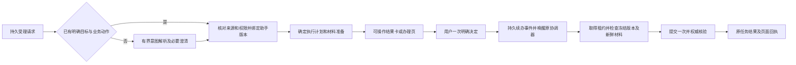

# 系统响应耗时分析与分批优化方案

2026-10-16 基于当前生产 Release `1acae4c34a71`、本提交代码、当前用户近期运行元数据和一次完整办理时序形成。用户已授权五批完整实施及发布，当前进展见[实施与性能验收](../验收记录/系统响应五批实施与性能验收-2026-10-16.md)；本方案中的目标不代替实测达成情况。

核心判断：等待来自多层串行链路叠加。优先减少已确定业务的模型往返、确认后协调等待和适配器重复读取，同时补齐真实时间轴。连接、页面收敛和长查询也有明确优化点，收益应分别衡量。保留一次明确决定、原协调器租约、材料新鲜度检查和权威核验。

## 一、样本与统计口径

| 窗口，均为北京时间 | 当前用户样本 | 用途与限制 |
| --- | --- | --- |
| 10 月 10 日 00:00 至 10 月 16 日 11:48 | 40 次 Workspace 请求、49 个业务操作、24 个任务、435 个阶段记录 | 主要近期基线；包含验收和测试请求，跨数次发布；37 次对话轮次完成，3 次失败 |
| 10 月 1 日 00:00 至 10 月 16 日 11:49 | 96 次请求、126 个业务操作、115 个任务、1,353 个阶段记录 | 补充照明、日志、语雀、通讯录和证照等场景；包含前一窗口，不能相加；跨多个版本，不用于评判本轮发布回归 |
| 当前发布后至采样时 | 8 次 Workspace 请求，均完成本轮对话 | 样本很小，其中今日 2 次；首次正文输出中位约 33 秒，范围最大约 134 秒；不据此承诺生产分位数 |
| 今日补签办理 | 1 条完整用户决定及提交链 | 精确拆分入口准备和确认后等待；不将单例推广为全部写操作分布 |

全部 SQL 采用只读连接和 `query_only`，限定当前用户及时间窗口；未读取聊天正文、业务参数、审批意见或凭据。仅对已定位的当前 Workspace 会话提取宿主转录的时间、角色、工具名称和用量元数据。没有增加业务操作或执行压测。每表上限 30,000 条，本轮均未截断。

分位数采用 nearest rank。完成轮次与失败轮次分别统计；不能通过快速失败降低“成功完成耗时”。`firstChatDelta` 是首次正文流输出，卡片可能更早出现；`hostFinished` 是一轮宿主对话结束，可能停在等待用户的卡片，不能当成审批完成。任务创建之前的规划时间不在任务耗时中；登录、填写、人工确认时间不纳入系统处理预算。

近期 37 次完成轮次的主要数据：

| 指标 | 中位数 | 观测 P95 | 解释 |
| --- | ---: | ---: | --- |
| 持久请求创建 → 宿主受理 | 1.50 秒 | 2.16 秒 | 入口受理相对较快，不能解释后续几十秒 |
| 持久请求创建 → 首次正文流输出 | 33.26 秒 | 97.81 秒 | 不是首次可操作卡片，也不是业务完成 |
| 持久请求创建 → 本轮宿主结束 | 36.00 秒 | 100.54 秒 | 与上项同为 37 个完成轮次，不含 3 次失败 |

业务调用本身通常更短。下表从 10 月 1 日以来的成功操作抽样统计，样本小的场景只列范围；这些是中央 Operation 时间，尚未包括模型规划、所有页面预检或前端呈现：

| 能力 | 成功操作数 | 中位或范围 |
| --- | ---: | --- |
| OA 待办查询 | 21 | 中位 2.51 秒，最大 3.91 秒 |
| OA 详情读取 | 5 | 中位 4.87 秒，最大 5.50 秒 |
| OA 补签审批 | 5 | 中位 8.09 秒，最大 10.91 秒 |
| OA 周报阅办 | 3 | 约 7.15—7.21 秒 |
| 照明告警查询 | 9 | 中位 0.85 秒，最大 1.45 秒 |
| 本人工作日志查询 | 6 | 中位 0.79 秒，最大 1.20 秒 |
| 语雀文档查询 / 读取 | 各 8 | 中位分别 2.39 / 2.87 秒 |
| OA 证照搜索 | 2 | 31.94 / 36.40 秒，属于适配器本身也慢的场景 |

另有一条历史补签提交结果 unknown、操作耗时约 65.77 秒，单独保留，不混入成功审批数据，也不因本方案重新提交。样本中的 `adapter.request failed` 还包含正常的字段/授权交互异常：近七天 21 条中，13 条 `FIELD_INPUT_REQUIRED`、7 条 `WRITE_AUTHORIZATION_REQUIRED`、1 条 `SESSION_EXPIRED`，不能称为 21 次业务失败。

## 二、这次七十秒如何产生

宿主转录外层 `timestamp` 是批量补写时间，必须使用内部 `message.timestamp` 并与中心操作时间交叉核对。以持久请求创建到任务进入等待用户为起止，可以闭合拆分为：

| 阶段 | 耗时 | 事实与归因边界 |
| --- | ---: | --- |
| 请求创建 → 宿主用户消息时间 | 1.411 秒 | 入站与受理 |
| 宿主用户消息 → 加载助手调用 | 21.730 秒 | 宿主准备、调度、模型请求等尚未分段 |
| 加载助手工具 | 0.886 秒 | 工具完整往返 |
| 助手返回 → 待办查询调用 | 12.562 秒 | 下一轮选择工具前的空档 |
| 待办查询工具 | 7.384 秒 | 其中中央能力约 2.479 秒；其余约 4.905 秒含控制调用、传输和包装 |
| 查询返回 → 准备办理调用 | 13.068 秒 | 又一次轮间空档 |
| 准备调用 → 可信入口就绪 | 13.177 秒 | 其中适配器约 7.294 秒；不是完整工具返回时刻 |
| 合计 | **70.218 秒** | 约 47.360 秒在宿主/模型轮间，21.447 秒在工具链内 |

完整准备工具耗时 14.600 秒，略晚于卡片已就绪；不能将它再加到上表。各层 span 相互嵌套，不能逐项求和当端到端耗时。初次普通待办查询同样在宿主用户消息到查询调用之间等待约 24.777 秒，说明慢入口不只发生在处理动作。

最后一次模型回复记录约 39,552 个缓存输入、412 个新增输入、40 个输出；缓存已经对该次调用生效。其他工具调用的用量写成 0，属于缺少可用计量，不能推导整轮零消耗或全轮缓存命中率。当前模型为 `openai/gpt-5.6-sol`，工具配置为 coding；插件模型可见目录包含 107 项，实际还按身份裁剪。应测每轮模型请求的发出、首 token、结束、重试和令牌量，再决定工具集合与模型配置。

确认后是另一条确定性链：11:05:59.628 决定落账，11:06:12.873 中央提交操作开始，11:06:23.384 操作完成，11:06:24.175 任务完成。操作开始前约 13.244 秒，操作执行及核验约 10.511 秒，总计约 24.547 秒。Operation 开始可能早于会话锁获取和真正进入提交边界，应另测下游发送时刻；不能称为 OA 已在该时刻开始处理。此阶段不依赖模型再次选择提交工具。相关通知首次领取距决定约 10 秒，与通知泵空闲时最长 10 秒退避相符，但现有记录不足以把全部空档归为轮询。

## 三、共性瓶颈与代码事实

### 1. 多轮模型编排与控制往返

[助手目录注入](../../integrations/openclaw-agentbridge/lib/plugin.js)在每轮提示构建中同步远程读取目录，[助手加载](../../integrations/openclaw-agentbridge/lib/business-skills.js)缺少专门的版本缓存和单轮合并。[业务工具代理](../../integrations/openclaw-agentbridge/lib/proxy-tools.js)依次完成任务确认、租约获取、业务调用、任务观察/结束及交互恢复。示例查询的业务调用只有约 2.5 秒，整个工具约 7.4 秒，证明控制面也占据时间，仍需拆出每个往返。

改进：从结构化查询结果直接选择目标，在服务端校验来源、权限并绑定固定助手版本，直接准备对应动作；自由文本先解析意图，确定后的业务步骤走封闭执行计划。任务确认与租约获取可以合为原子入口，业务响应同步写入原任务观察结果，减少往返而保留原有安全事实。助手目录按用户及目录/权限版本缓存，执行绑定仍实时验证。对常见业务收敛工具集合，对未确定请求提供受限发现入口。

### 2. 确认后的事件发现和队首阻塞

[协调器](../../integrations/openclaw-agentbridge/lib/coordinator.js)通知泵空闲时从 2 秒递增至最多 10 秒；领取通知后顺序处理，恢复交互会等待整次业务续跑才确认通知并处理下一条。一次慢提交会阻塞同一端点后续通知。恢复已完成授权时还会先请求 presentation，再取得租约续办。

改进：决定事务中同时记录持久续办事件，提交事务后立即通知原协调器；采用长轮询或事件通道，2 秒轮询仅作恢复保底。领取与实际执行解耦，同任务串行、不同任务有界并发；原租约和 fencing 版本决定唯一执行者。展示签发与已确认决定的执行分开，任何重复通知都只观察同一个幂等操作。

### 3. 会话排队、重复浏览器启动和完整读取

[中心执行器](../../agentbridge/core/central_service.py)在整个适配器 I/O 期间持有同一会话锁；会话活动、保活、预检和提交还共享该锁。部分活动记录在适配器 span 之前已经可能等锁。增加线程不能让同一会话安全地并行写入。

[OA worker](../../agentbridge/browser/central.py)每次上下文启动并关闭 Chromium。首次材料读取、草稿预检、确认前重查和正式提交各自可能重新启动、探测账号、读取列表与详情。[详情读取](../../agentbridge/adapters/seeyon_central.py)每次固定等待 1.8 秒，四个阶段合计可能包含 7.2 秒固定等待，但不能把这直接当成本样本可一次扣除的收益。

改进：先复用一次能力调用内的 worker、身份探测和路由发现；以表单/frame/材料完整及短稳定窗口代替固定 sleep。将意见编辑的本地规范化与材料读取分开；最终提交前仍做一次权威、新鲜、完整的材料核对。确认前重查与提交前检查若要合并，必须进入同一受控执行通道，保持材料指纹比较及写入边界检查，不能使用短期缓存冒充新鲜材料。长期热 worker 按用户/系统/会话代际隔离，单独保留 browser profile lease；账号或会话代际变化时废弃旧上下文，并提供失效、回收和重建机制。

[草稿服务](../../agentbridge/core/business_drafts.py)全局只有 2 个预检槽，且先占槽再等会话锁；同会话的两条预检可能占满其他用户容量。改为每草稿修订合并、每会话 single-flight、公平调度和有界队列；只读过时请求可取消，决定和提交不得因页面取消而重放。

### 4. 查询类型存在各自的真实慢路径

- OA 证照搜索默认顺序遍历类别，[菜单及结果读取](../../agentbridge/adapters/seeyon_documents.py)有多处 900 毫秒固定等待，每类别菜单链约 7.2 秒，再叠搜索词等待。优先改为可观察就绪条件、复用已打开类别及现有多名称入口。
- 照明和泰华已采用 HTTP worker，不能套用 OA 浏览器优化。[照明](../../agentbridge/adapters/smartlight.py)会话探测有刷新 JWT 和失败后 CAS 交换，分页统计串行；按剩余令牌寿命、身份版本和稳定分页能力决定可合并或小并发的只读请求。[泰华](../../agentbridge/adapters/taihua.py)团队查询还需解析组织和成员，缓存必须绑定权限版本；避免宽日期数据反复传输。
- [HTTP worker](../../agentbridge/browser/http.py)每次建立 CookieJar/opener；是否值得连接池化，需先测连接建立和下游首字节，不预设所有请求都重新完成 TLS 握手。
- [OA 写后核验](../../agentbridge/adapters/seeyon_pending_verification.py)必须保留完整待办覆盖和精确已办身份。减少每轮重复的模板探测/路由发现，按核验状态推进只读回查，并逐层传递剩余 deadline；写入边界后不得重新点击提交。

### 5. 页面与宿主桥继续叠加等待

[Gateway 桥](../../agentbridge/workspace/gateway.py)每次 RPC 都启动 Node 并新建 WebSocket；[发送链](../../agentbridge/workspace/gateway_client.mjs)串行经过旧 run 处理、会话查询、绑定和发送。正常 final 后仍需另一次权威历史读取。它们确有成本，但当前受理中位约 1.5 秒，不应把它列为 47 秒轮间等待的全部原因。

[页面加载](../../agentbridge/workspace/static/workspace.js)先等多组请求，再等助手记录、任务及最多 30 个详情，最后渲染；约为 7+N 个 HTTP 请求。现有 DOM 会保留节点，不应泛称每次全量重建。时间线服务每秒扫描、25 秒结束 SSE，前端错误后固定等 5 秒再连，造成周期性额外间隙。常态扫描与 220 毫秒事件合并通常只解释约 0—1.22 秒，不能解释整个入口等待。

改进：当前 timeline 和活动卡先显示，历史与详情按需加载；增加批量摘要和按版本增量接口。事务提交后唤醒事件发送，保持持久 cursor 重放；延长 SSE 并心跳，正常续接不固定等 5 秒，异常才退避。后续评估受控长驻 Gateway 连接、正常 final 的同通道权威结果、HTTP 持久连接。不能省掉旧 run 隔离、绑定、限流或权威结果校验。

### 6. 现有指标漏掉最关键的等待

[运行治理](../../agentbridge/core/runtime_governance.py)将 `host.first_progress` 的 span duration 与 15 秒比较，但[写入该阶段](../../agentbridge/core/central_service.py)时没有传请求起点，记录的是记账动作本身，不是请求到首反馈。近七天该阶段没有样本，不能把已有 SLO 当成本次体验结论。[草稿预检](../../agentbridge/core/business_drafts.py)直接构造上下文，缺少可关联的 preview/recheck 网络阶段。请求、宿主 run、任务和操作也不能稳定一一关联，本轮无法可靠得到所有请求的首卡时间。

改进：区分时间点事件与持续 span，用同一 request/dispatch/run/task/operation/decision 关联。跨机器保存墙钟及来源，进程内耗时使用单调时钟，并标记时钟偏差；服务端持久受理、模型请求/首 token/结束、控制 RPC、会话排队、worker 启停、材料/预检/重查、决定、续办唤醒/领取、提交边界、核验、事件发送、浏览器收到与 DOM 可操作分别计时。

采样时中心资源有余量，当前没有 CPU、SQLite 锁等待或磁盘同步导致几十秒延迟的证据。SQLite 已使用 WAL，草稿网络预检也已移出 writer 事务。先补锁等待、事务提交、WAL 和慢查询计时，再决定容量或存储专项。

## 四、目标流程

自然语言仍用于理解意图、处理歧义和跨系统分析。用户已在结果卡明确选定的对象，可直接进入绑定原始来源的确定流程；不能再以标题猜目标、重新选助手并重复多轮规划。

快路径不新增授权范围。只读提前准备必须受原身份、能力和资源范围约束；未知或失效来源返回原流程。额外 OA 警告仍需新的明确决定。卡片 HTTP 负责决定落账与唤醒，不成为第二套业务执行器。

## 五、分批实施

以下五批按依赖推进；每批更新阶段数据和文档，并独立做 Chrome 扩展 Workspace 验收。发布采用项目既有固定提交、Full、制品、上线及生产验收流程。只有文档更新不触发部署。

| 批次 | 实施范围 | 本批验收重点与进入下一批的依据 |
| --- | --- | --- |
| 第一批：真实时间轴 | 修正首反馈口径，打通 request/run/task/decision 关联；补模型、控制 RPC、锁、预检及前端时间点；建立可重复基准与统计报表 | 能闭合解释请求到首卡、决定到提交、核验到显示；日志无业务正文或秘密；观测开销有预算；人工等待单列 |
| 第二批：确认即时续跑 | 决定事务的持久续办事件；提交后唤醒原协调器；通知领取与业务执行解耦；同任务串行、跨任务有界并发；事件快速送达 | 正常决定到提交启动 P95 不超过 2 秒；崩溃、重复事件、租约接管、双页面及丢回复均不重复写；核验后页面及时更新 |
| 第三批：缩短业务编排 | 可操作查询结果与选定目标直达；固定业务计划；助手目录版本缓存/合并；合并任务确认及租约入口；常见业务工具集合和模型配置对照试验 | 原样本的三轮模型选工具路径显著减少；不削减权限、来源或助手绑定；歧义回退正确；同时比较响应、工具选择及业务准确率 |
| 第四批：适配器和会话 | 移除固定 sleep，调用内复用 worker/probe/路由；预检合并和公平调度；安全合并最终重查通道；证照、分页、令牌刷新专项 | 分系统记录真实下游请求数、worker 启停、材料读取次数；材料变化和未知不重放不退化；长查询不饿死确认提交 |
| 第五批：页面与连接 | 当前结果优先、摘要批量/增量、历史按需；长连接与心跳；Gateway 复用、final 精确回读；必要的 HTTP 持久连接和恢复队列治理 | 卡片/终态送达 P95 不超过 1 秒；长历史、刷新、断线恢复、旧 run 和多个任务一致；无新增连接泄漏和限流退化 |

第二批先解决可明确消除的确认后长等待；第三批处理入口准备的主要时间。连接重构排在测量之后，避免先投入复杂基础设施却只缩短少量受理时间。适配器热 worker 和数据库迁移不与低风险去重改造捆绑上线。

## 六、初始性能目标

下表是拟定工程目标，不是已实现结果或生产 SLA。完成第一批后根据冷/暖、数据规模和模型供应链测量校准；所有分层都同时公布全体请求、失败率和排队分布，不能只保留快样本。

| 指标 | 清晰起止点 | 初始目标 |
| --- | --- | --- |
| 持久受理 | 浏览器发送 → 服务端 durable dispatch commit | P95 ≤ 0.5 秒；当前未完整测量此段 |
| 宿主受理 | durable commit → host accepted | 暖态 P95 ≤ 2 秒，当前观测约 2.16 秒 |
| 简单自然语言查询 | 用户发送 → 首个正确、可使用的查询结果 | 暖态中位 ≤ 8 秒，P95 ≤ 15 秒 |
| 已选事项进入办理 | 点击明确目标 → 材料及最终按钮可操作 | 中位 ≤ 5 秒，P95 ≤ 10 秒 |
| 自然语言准备常见动作 | 用户发送 → 可操作办理入口 | 中位 ≤ 10 秒，P95 ≤ 20 秒 |
| 决定后续跑 | durable decision → 原协调器开始精确 commit 操作 | 无前序写占锁时 P95 ≤ 2 秒，排队另列；现有单例约 13.24 秒 |
| 常见单项 OA 完成 | durable decision → 权威核验后任务终态 | 健康、正常规模场景中位 ≤ 10 秒，P95 ≤ 15 秒；现有单例约 24.55 秒 |
| 结果呈现 | 卡片/核验终态提交 → 浏览器可操作/显示 | P95 ≤ 1 秒 |

复杂分析、跨页证照搜索和大报表另按数据量设预算，先交付可验证的分段结果、明确覆盖进度，再完成总体结果；不将局部查询当作完整结果。用户主动填写、登录和确认的时间单独显示，不能算作系统慢；正在等待同会话真实写入的队列时间仍公开记录。

决定后 2 秒目标仅表示原提交操作已进入执行，不表示下游已经收到写入；同时公布决定到提交边界/下游发送的耗时，防止提前创建 Operation 掩盖后续排队。

## 七、验证、质量与发布

建立跨场景基准：OA 待办/详情/通讯录/证照，照明告警及统计，日志个人/团队查询，语雀检索，数据库分析，28 个业务动作的准备/决定/结果，以及混合与旧补签批次接续。数据库分析还需补与独立查询执行面的关联，不能从中央能力的 126 条样本推断其耗时分布。

每类区分短/长会话、冷/暖连接、正常/过期登录、短/长材料、单页/多页、轻载/受控并发。基准保留版本、数据规模、模型与工具配置、缓存状态和重复次数。每个关键组合先做不少于 30 次可重复隔离样本，分别报告中位、尾部和最大值；生产小样本只列数量、范围及观测分位，不宣称稳定达标。

模型对照采用同题、相同工具与权限、交错顺序，比较完整正确完成率、目标定位、助手模式、澄清必要性、工具轮次、首结果及总耗时；不能用截断回答或漏掉业务范围换快。当前模型和版本作为基线，只有达到质量门槛再切配置，保留独立回退。

每批 Workspace 验收都实际观察发送、真实进度、可操作卡片、刷新和最终回执，分别记录服务端时间和浏览器呈现。恢复、取消、双标签、重复通知、租约接管、材料变化、额外警告、未知停止与批次顺序均为必要回归。隔离写入使用合成下游；生产写入样本来自已获明确决定的实际业务，不为采性能样本制造审批。

回退粒度为事件唤醒、工具合并、助手缓存、预检优化、worker 复用、页面增量、Gateway 通道各自可开关或独立回退。fallback 仍消费同一持久操作和幂等键；已经尝试提交后只能恢复观察及只读核验，禁止切旧路径再执行一次。

## 八、外部依据与证据保存

[OpenAI 延迟优化指南](https://developers.openai.com/api/docs/guides/latency-optimization)建议减少请求轮次、并行独立步骤，以及对确定的确认和结果展示使用普通程序或专门界面。这与本项目“意图由模型理解、确定步骤由受控执行器完成”的方案一致；不能据此估算本项目一定能节省多少秒。

[OpenClaw 队列说明](https://docs.openclaw.ai/concepts/queue)解释了会话串行和跨会话并发的区分；增加全局并发不等于加快同会话任务。[缓存说明](https://docs.openclaw.ai/reference/prompt-caching)说明缓存计量受提供方影响，[上下文裁剪说明](https://docs.openclaw.ai/concepts/session-pruning)区分裁剪与压缩。当前生产固定 OpenClaw `2026.7.1`，最新文档中的选项和行为须先与本机已安装代码核对，不能直接套用。

私有证据目录为 `~/.local/state/agentbridge/latency-analysis-20261016/`，保存只读采集脚本、两窗口元数据、统计计算、精确会话转录元数据与分析结果。公开方案只呈现必要计时、数量和技术路径，不包含用户身份、业务正文、工具参数、会话键或可信交互 URL。统计口径和方案已经独立只读复核，文档定向检查、公开内容凭据模式检查与差异格式检查通过。上一轮单例现场记录见[真实办理复核](../验收记录/协同办公待办查询与单次办理实测复核-2026-10-16.md)。
