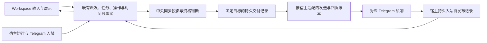

# 工作台与电报双向同步统一设计

设计日期：2026 年 11 月 27 日。状态：**四批已集成，生产仍运行 `87765c133e20`。上一发布候选已过 Full；本轮正在补验来自 Workspace 和 Telegram 的新可信卡关闭状态。**。本文基于当日三宿主源码审计、生产只读对账及隔离探针，规定 OpenClaw、NanoBot、Pi 的 Workspace ↔ Telegram 同步目标。设计目标不直接作为完成证明；已实现范围、真实端点观察与尚未签收事项见本文末尾和验收记录。批次边界见[分批实施方案](../后续规划/工作台与电报同步分批实施方案-2026-11-27.md)，当前证据见[四批实施与验收](../验收记录/工作台与电报同步四批实施与验收-2026-11-27.md)。

## 一、结论与范围

需要统一的是：**哪些事实应同步、如何绑定原请求和收件人、何时允许发送、什么证据算送达，以及失败后怎样恢复。** 中央负责交付规则和业务来源；各宿主适配器负责平台传输、持久发送账本和回执。复用现有任务、操作、时间线、结果视图、文件和通知能力，不新增通用业务事件总线，不合并三个宿主的模型会话。

本设计覆盖两个方向的公开问题与回答、运行终态、可信交互状态、OA 查询结果入口、获准图文与文件、配对代次和明确接续。每个事件只投向**同一主体、同一宿主实例、当前获准的对应端点**，不会因为用户拥有三个 Bot 而广播三份。更换默认宿主只影响新请求，原任务仍归原实例。

统一后，用户从任一宿主的 Workspace 查询 OA，在该宿主的本人 Telegram 私聊应看到关联的问题、公开结果说明和符合条件的结果入口；从 Telegram 发起的公开问答和获准附件应在同一实例的 Workspace 可查。快捷查询没有模型答复时，由中央生成确定性的公开完成说明，不额外运行模型或重查业务。出现失败、停止、过期、不支持或发送未知，应有准确状态，不能以静默消失代替。

本轮账号范围由用户明确为：**第一账号使用真实 Telegram，第二账号仅使用 Workspace**。另一账号在同宿主网页不可见原内容，是网页隔离证据；不能称作第二真实 Telegram 客户端。Pi 第二 sender 拒绝仍以注入更新等隔离方法验证，不扩展实际私聊名单。

以下边界保持不变：`prepare → authorize → commit → verify`；材料有效期与权威业务核验；可信内容不进模型及普通日志；当前账号开放范围；Pi 首账号私聊限制；技能草稿和试用隔离；业务未知结果不重放。微信、所有宿主完整聊天合并、自动补发历史消息、新增业务权限不在本次范围。

## 二、问题依据与证据限度

当日生产样本时间均为北京时间，业务明细、账号标识及短期链接不进入本文。部署快照中央为 `87765c133e20`，本轮文档工作起点为 `46318e21`；后续实施须重新核对实际加载版本。

| 观察 | 已确认事实 | 解释与限制 |
| --- | --- | --- |
| OpenClaw，09:15、09:23 的 Workspace 查询 | 均走固定快捷查询；OA 读取各一次成功；有问题镜像，无助手时间线与结果视图投递 | 网页显示的完成说明来自任务投影，不等于已有可镜像的助手消息；直接 Telegram 查询走另一条路径 |
| NanoBot，09:21 的 Workspace 查询 | OA 读取一次成功；公开答复已获出站确认；无结果视图投递 | 文字与结果卡是不同路径；中央当前跨端结果视图限 Pi |
| Pi，09:22 的 Workspace 查询 | OA 读取一次成功；公开答复与一个结果视图均获出站确认 | 证明此样本正常，不能据此推断登录、故障、媒体等全路径已对齐 |
| NanoBot，09:16 的另一运行 | `HOST_RUN_RESULT_UNAVAILABLE`；网页存在错误答复，未形成对应 Telegram 公开终态 | 宿主运行未知的原始原因尚未定位，不能归因于 OA；同步缺口可独立确认 |
| 本人 11 月 23 日以来 238 条 Telegram outbox 记录 | 当时均为 acknowledged，无待处理项 | 包含静默处理；不能证明每条都发到 Telegram，更不能发现根本未入队的结果 |

主要代码依据：[快捷查询](../../agentbridge/core/quick_queries.py)、[Workspace 入口](../../agentbridge/workspace/static/workspace_forms.mjs)、[任务投影](../../agentbridge/workspace/static/workspace_cards.mjs)、[中央出站规则](../../agentbridge/core/tasks.py)、[跨端结果来源](../../agentbridge/core/workspace_result_views.py)。全部差距及证据级别列在实施方案 D01–D14。隔离探针发现不等于生产已发生重复或丢失；已有生产对账也不替代未来候选的运行验收。

## 三、职责与信息流

| 层 | 负责 | 不承担 |
| --- | --- | --- |
| 既有业务与运行账本 | 原受理、运行、任务、操作、结果和授权事实 | 用投递成功推断业务成功 |
| 中央同步投影 | 从事实产生稳定事件；选择目标；记录允许或不发送的原因；维护版本和因果引用 | 重跑模型、重查 OA、按最新一条结果猜来源 |
| 交付账本与协议 | 固定来源、目标和配对代次；冻结分段；领取、发送许可、证据结算 | 把租约到期视作外部平台没有收到 |
| 宿主传输适配器 | 发送前复核、平台调用、结构化错误、持久回执、入站补写 | 自行扩大收件人、业务权限或材料期限 |
| Workspace 与管理视图 | 展示原内容、当前交互状态和真实同步状态 | 把中央 ACK 显示成用户已读 |

公开文字、可信卡、受保护附件保持三种载荷。可信卡只传交互/来源引用，在获准私有路径中签发；附件只传受控资源引用并再次校验。任何一种载荷被拒绝，不能连带丢弃同轮其他允许公开的内容。

## 四、事件、身份与协议

### 来源身份

使用现有原始标识组成稳定事件身份，内容摘要只用于冲突校验。相同文字的两条不同 Telegram 消息是两件事；同一消息的重复回调仍是一件事。

| 来源 | 必须绑定的身份 |
| --- | --- |
| Telegram 入站 | 主体、实例、Bot、私聊、原 message ID、事件种类、接纳时的配对证明 |
| 普通 Workspace 问答 | 问题以真实 request/message、原会话和 dispatch 为根身份；受理后追加 accepted run，产生任务后追加 task/operation，不改变原 event ID；终答要求对应的原受理证明 |
| Workspace 固定快捷查询 | 问题以原会话、快捷 command/request ID 为根身份；创建任务/完成读取后追加 task 和唯一原 operation；**不要求虚构普通 dispatch/run** |
| 运行终态 | 接纳前失败/取消以真实 dispatch/request 为根身份；受理后附显式 source run；快捷查询沿原 command/request；另有 outcome 和事实修订，不解析 `workspace:assistant:error:*` 推测来源 |
| 可信交互 | task、interaction、交互修订与当前状态；同任务可有多张卡 |
| 文件或图片 | 原请求/任务、资源 ID、不可变内容摘要、顺序和来源版本 |

每个事件包含 `event_id`、`source_kind`、原身份引用、`origin`、`content_revision`、`content_hash`、发生时间及公开内容分类。`origin` 与原事件引用用于防止镜像回声，不能靠比较文字判断回声。相同事件 ID 出现不同主体、来源绑定代次或内容时拒绝并记录冲突；目标代次属于交付，不能混入来源冲突判断。问题和接纳前终态不等待尚未产生的 run/operation，结果卡仍须证明完整原操作来源。

每条目标交付固定 `delivery_id`、`event_id`、目标端点、原配对代次/证明、内容种类、协议版本、到期时间及资格结论。唯一键覆盖事件、目标、配对代次、内容种类和内容修订；新修订必须是来源明确产生的新事实，不能通过改变摘要绕过去重。另有跨协议唯一发送归属，保证同一逻辑事件与目标不会被新旧队列同时发送。

### 持久化边界

以下是最终需要表达的逻辑记录，优先扩展既有任务、操作、outbox 和本地收据，不要求首批先建完整通用平台。第 1 批仅补齐 OA 路径必需的来源、资格、发送边界及回执；第 2 批推广通用协议和持久入站。确需独立结构时复用既有 outbox 的服务边界和领取基础，不直接让旧消费者理解新状态：

1. 来源投影与资格结论：只保存既有权威事实的引用、摘要和必要公开内容，记录 `eligible`、`no_destination`、`unsupported`、`origin_handled`、`private_content`、`expired`、`revoked` 等明确原因。
2. 目标交付：固定目标、协议、代次、状态与原因，保存发送许可及结算引用。
3. 交付分段与尝试：冻结格式化版本、内容摘要、顺序、段数、互斥表示、`send_attempt_id`、平台回执和状态迁移历史。
4. 宿主本地账本：持久入站待发布和发送证据。优先扩展 NanoBot/Pi 现有记录；OpenClaw 补齐持久化，不能继续仅靠内存重试。

第 1 批实施前固定 OA 路径必需字段和事务边界；第 2 批冻结并推广其余通用结构，复用首批身份与收据。能与原事实同库提交的投影在同一事务登记；跨库存储用原事实库的持久待投影标记，再幂等写入目标库，不能宣称跨库天然原子。补偿只处理已登记的原事件，不扫描历史重新生成消息。文本与收据有明确保留期限；敏感卡链接、密码、授权字段和文件正文不进入通用记录。

正文可以按期清理，稳定事件/交付身份、发送终态、撤销代次和必要去重墓碑必须至少覆盖所有可回放、重领和受支持回退窗口。低于已封存保留水位的旧事件只返回过期，不能因正文或收据已清理而重建可发送副本。首批冻结 OA 路径的保留窗口并验证清理后不重发；第 2 批将规则推广到通用旧回调、旧 outbox、入站与恢复副本。持久化失败时不能推进接纳游标或谎报已登记。

### 能力协商

新私有同步协议版本必须由受信注册、已验证适配器版本、当前主体/实例权限和配对共同准入。使用宿主名判断能力或仅相信宿主自报均不合格。现有 `agentbridge.host.v1` 的 capability 枚举和 schema 严格固定，不能直接插入新字段；第 1 批冻结本路径必需的受信能力证明，第 2 批推广独立的版本化同步 profile；确需改变既有契约时正式升级契约及共享向量。[现有宿主契约](../../agentbridge/core/host_contract.py) · [现有严格 schema](../../schemas/agent-host/v1/host-capability-profile.schema.json)

语义操作分为 `ingest_event`、`claim`、`validate/begin_send`、`settle_receipt`。具体路由在实施前固定，均属于宿主私有面，不能作为模型可调用的任意消息发送工具。旧消费者只能领取旧协议；能力未就绪时记录不支持或保留原路径，不能生成无人能够处理的新消息后假 ACK。

## 五、发送、确认与恢复

### 状态与边界

资格、平台传输、中央结算分别记录；以下状态是便于描述的交付视图，不能用单个 ACK 覆盖全部事实。

| 状态 | 证据与恢复规则 |
| --- | --- |
| pending / retry_wait | 确认尚未产生外部消息；按错误类型、预算、有效期有界重试 |
| leased | 已领取但未取得发送许可；租约过期可重新领取 |
| send_started | 中央已冻结本次发送许可，本地已持久记录发送边界；不能因租约到期重新发送 |
| sent_pending_ack | 正确 Bot/私聊/message ID 回执已落盘；只补中央结算 |
| acknowledged | 中央已保存该发送回执；仅代表平台接受消息，不代表用户已读 |
| delivery_unknown | 外部消息可能已产生但无可靠结果；停止自动补发，保留证据 |
| rejected / expired / revoked | 明确不可继续，保留具体原因；新配对不能复活旧交付 |
| suppressed | 按规则无需发送，如原端已处理；不能展示为已送达 |

顺序为：领取 → 读取/渲染 → 当前配对、权限和材料期限复核 → 中央授予唯一发送尝试并持久化本地边界 → Bot 调用 → 校验并落盘平台回执 → 中央结算。每段发送前都复核当前资格。`begin_send` 使用稳定幂等键，重试只能返回原尝试及状态，不能产生第二次许可。有效租约和唯一 Bot 消费者/进程交接锁共同防止并发；新 worker 不得抢发已经越过发送边界的段。

中央或本地任一发送边界记录已经成立，另一方回执缺失时均按保守状态恢复；双写之间不能用猜测补造“未发送”。发送许可落盘后、真正调用平台前崩溃，也可能只能保留 unknown。平台成功后、回执落盘前崩溃同样如此。持久化不能消除这些不确定窗口。

### 错误分类

- 绑定服务暂时不可用、签发/读取失败等发生在发送许可之前，且 Bot 调用为零：允许有界恢复；真正撤权、换绑或到期直接终止。
- Telegram 结构化响应能明确证明没有产生消息时才归为明确拒绝；经合同及故障注入验证的 429 按 `retry_after` 和预算重试，永久内容错误结束并说明。
- 网络超时、响应丢失、无法解释的服务端错误、错误目标或缺失回执：默认 unknown。不能把所有非 200 都当 unknown，也不能把所有 5xx 都当安全重试。
- 平台回执已持久化而中央确认丢失：重启仅补结算，Bot 调用不增加。

SDK、渠道封装及 HTTP 客户端不得对跨过发送边界的消息请求做隐藏自动重试。第 1 批先核实 OA 路径真实发送栈的重试、超时和取消语义，第 2 批覆盖其余入口；测试统计实际传输请求数，不能只统计适配器方法调用。只有明确证明未发送的错误，才可由持久账本登记后进行有界新尝试。

`settle_receipt` 是只记录历史事实的通道。由仍具受信身份的原实例适配器提交，校验原发送尝试、内容摘要、历史目标和可信回执后，允许迟到的正回执收敛原 unknown，即使原租约已过期或当前配对已撤销；它不赋予新发送、签卡、下载或续办权，也不允许匿名或失去实例认证者提交。不能假设 Telegram 支持查询任意丢失消息；没有可靠证据的 unknown 保留。人工要求再发时是新的明确请求，仍展示原未知记录及可能重复的事实。

### 分段、顺序和入站补写

发送前冻结 UTF-16 长度计量、格式化版本、每段摘要和顺序，适配平台已验证的文本/caption 上限。重启使用原切分结果，不用新版格式化器重新切。第 N 段 unknown 时保留前段回执、暂停后续相关段，禁止重发全文。部分成功由各段聚合，不覆盖已完成段。附件原生发送和获准链接后备是互斥表示；只有明确没有发送才允许后备，未知不能换一种格式再发。

问题、回答、同源卡可有因果依赖；某一轮 unknown 不应永久阻塞同私聊后续独立请求。中央可以保存完整原答复，同时单独展示 Telegram 哪些段已确认；不能把全文可查误报为全文已送达。

Telegram → Workspace 在入站游标推进或处理确认之前持久登记原事件和待发布记录。中央超时后重试同一事件；中央已写入但本地 ACK 丢失时只重发幂等登记，不重新启动模型。OpenClaw 必须验证其渠道钩子是否支持该持久接纳点；若缺少回执或发送边界接口，先补接口，不能提前宣称符合可靠性合同。换绑后终止或隔离旧代次待发布项，不能改属新主体。

## 六、各内容类型的统一规则

| 内容 | Workspace → Telegram | Telegram → Workspace |
| --- | --- | --- |
| 公开问题与答复 | 普通/快捷/带附件请求分别有原身份；公开内容独立判断，不以已有问题出站为终答唯一前提 | 保存原消息及公开答复；镜像不再次触发模型；完整答复与 Telegram 分段送达分开显示 |
| 运行与业务终态 | 用显式 run/请求引用投影失败、停止、未知及安全摘要 | 保存同一事实和来源；运行停止不冒充业务取消或提交未发生 |
| 登录、字段、授权卡 | 沿用交互私有信封，按目标端点签发；出现过卡不等于后续所有文字都私密 | 同一 interaction 的最新状态；字段和授权材料不进入普通时间线 |
| OA 结果入口 | 从唯一合格的原读取生成结果来源；不等待模型终答或普通镜像 | 保留原端结果身份，网页查阅与接续仍经过现有结果视图权限 |
| 图片与附件 | 说明文字、资源引用、同轮终答独立交付；逐件确认 | caption、原附件顺序和受控引用入站；不把不可访问链接交给模型 |
| 业务产物文件 | 按原任务和资源策略决定是否允许跨端，逐件授权；受保护 CSV 不降级公开链接 | 本人网页按原资源权利续取，保留期与短期入口期限分别呈现 |

### 查询结果来源

结果卡由中央权威操作完成事件触发，使用既有 `ResultViewService`。来源分为普通 dispatch/run 与快捷 command/task 两个受控分支，分别证明原受理，不以“补造 run”统一。两分支都要求同一主体、实例、原会话、任务、唯一原 OA 读取、完成时刻、结果摘要、完整一致的待办集合和有效期。

直接成功、首次轮询即终态、登录后原查询完成均走同一来源判定。首轮只支持已证明的单次 OA 待办读取；混合任务、多次读取、缺失来源、部分结果或来源后来变化时不猜最新操作，不签可办理结果卡，并给安全原因。空结果给“无待办”说明，无选择项时无需制造卡。后续新增操作造成原唯一性证明失效时，领取、签发、打开、刷新和 prepare 都重新拒绝旧证明。

跨端结果记录只授予展示资格。目标专用短期链接在发送前签发，打开、准备、授权和提交仍走当前身份与材料校验。补投、重签及中央确认均不得重查 OA；只有用户明确刷新才产生新的受控读取。快捷查询的公开完成说明与结果入口分别去重；普通模型答复保留，但不靠模型文字推导业务真实性。相关模块：[结果来源](../../agentbridge/core/workspace_result_views.py)、[原端结果视图](../../agentbridge/core/telegram_result_views.py)、[中央工具](../../agentbridge/mcp/central.py)。

### 终态、长文本及旧卡

终态明确区分宿主失败、接纳未知、模型停止、业务失败、业务未知、发送未知。同步恢复不触发业务恢复。终态事件按原事实版本单调更新；迟到的旧进度不能覆盖新终态。公开摘要来自明确允许的字段，不通过简单删除 `had_card` 过滤放行所有卡后文本。

Workspace 保存允许留存的完整答复；Telegram 采用统一、有界的分段策略，超过产品总上限时给截断说明和本人安全历史入口，不能在 50,000 字附近整条静默丢弃。第 1 批先保证 OA 答复有界且明确说明超限；第 2 批按基线统一三宿主的通用总量、段数与逐段恢复策略。

卡片以 interaction ID 与修订管理生命周期，不按 task 强行合并。已记录 message ID 且渠道支持编辑时，可去除失效操作并更新状态；否则追加一次去重的状态通知。即使外观未能更新，旧按钮服务端也必须拒绝失效材料。刷新、长停留、离线恢复和另一端消费后均显示当前状态，不把外观更新当授权撤销手段。

已收到的新卡在宿主长时间离线后仍须核对关闭状态。恢复时复核原正回执、当前配对及原交互的权威状态；尚未领取的公开关闭提示从首次领取起计出站时限。原卡有效期、旧发送尝试和送达未知分别按原记录处理。

### 附件与摘要

复用 [Workspace 附件存储](../../agentbridge/workspace/stores.py)、[Pi 图片路径](../../agentbridge/workspace/pi_timeline_media.py)与[业务文件策略](../../agentbridge/core/telegram_artifacts.py)。从“有附件就排除整轮镜像”改为逐项分类；技能试用、私有草稿等原隔离边界继续生效。

NanoBot 入站区分完整请求摘要与公开提示摘要，完整摘要覆盖规范化 caption、附件不可变身份、类型和顺序；校验两端使用同一规范，不再把 JSON 请求摘要与纯文字摘要比较。调查时局部探针仅证明摘要不一致；第三批已取得完整归档 SDK 附件链和 NanoBot PDF／Pi PNG 的真实反向样本，其他类型和异常按各自证据记载，不从单一样本推定全部通过。[入站媒体](../../integrations/nanobot-agentbridge/nanobot_agentbridge/telegram_media.py) · [入站时间线](../../integrations/nanobot-agentbridge/nanobot_agentbridge/telegram_timeline.py)

## 七、配对与明确接续

配对统一表达主体、实例、Bot、私聊、授权方式、代次、生效/撤销状态及兼容来源。NanoBot 未迁移用户保留借用 OpenClaw 旧绑定的兼容路径；迁移采用现有本人 Workspace ↔ NanoBot Bot 的双向挑战，旧映射仅作为候选提示，不自动升级长期授权。

第 1 批启用新协议前，必须先有最小撤销保护：冻结并复核现有有效 pair proof，持久记录撤销/禁止回退，阻止撤销后从旧路径重新取得发送权；保护覆盖新旧发送入口，不能识别该约束的版本不得接管受保护范围。完整独立配对和本人挑战迁移仍在第 4 批实施，不用提前重绑用户或改写历史证明。

独立配对验证完成后优先使用新授权，持久保存“禁止旧授权回退”标记。撤销时保留撤销代次和该标记，不能删除新记录后重新借用旧 OpenClaw 配对。迁移同时固定最低兼容授权版本；不能识别该标记的旧中央验证器或消费者不得接管已迁移范围。撤销检查同时覆盖旧代次 pending，历史回执结算单独保留。冲突主体、多个 sender、换 Bot 或换实例均不能自动迁移。未迁移用户保留明确标识的兼容模式及原检查；已迁移用户不再依赖旧宿主活跃状态。[当前配对实现](../../agentbridge/workspace/telegram_pilot_links.py)

第四批实现另固定入站代次与原消息时间：新独立配对只接受能证明晚于本代生效时刻的原私聊消息，Telegram 只有整秒时间时，与迁移同秒的不确定消息在模型接纳和首次历史登记前拒绝；不能让旧 backlog 被新配对认领。已存在且原主体/实例/凭据/消息摘要均一致的文字或附件事实只补原回执，不回填缺少身份的遗留授权，不因此获得新发送、签卡或资源读取权。未迁移的兼容配对保留原有检查。

迁移不修改旧交付的 pair proof。旧 pending 在原授权有效且未越界时有界收尾；撤权后终止。旧 unknown 保留原代次和不确定事实，不作为新代次补发。Pi 名单和私聊开放范围不因此扩大。

同步可见不等于模型共享记忆。当前第四批通过原消息按钮生成精确引用，或使用“继续网页消息／继续电报消息＋原 entryId”明确指定来源；中央复核同主体、同实例及原接收/投递事实。模糊的“继续刚才那个”不能自动猜成最新一条；缺少唯一可核验来源时要求明确选择，无权或过期拒绝。只将必要的公开摘要、来源和受控资源引用作为不可信上下文传给模型；不拼接全部聊天，不传可信卡材料，不从上下文取得执行权。跨端确认仍消费原任务授权，宿主变化不转移协调资格。

## 八、可观测与性能

每个被评估的事件都能查到：来源 → 资格结论 → 目标/无目标原因 → 领取 → 发送前复核 → 尝试 → 平台回执 → 中央结算。无入队、静默处理、网页可拉取、原端已处理、平台已接受、未知分别展示。管理台停止把所有 acknowledged 统一标为“已送达”；用户端按需显示“待同步／已同步／部分同步／同步未确认／无法同步”及安全原因，不展示内部表名或协议术语。

测量受理、业务完成、来源投影、入队、领取、复核完成、发送开始、平台回执、中央确认、页面首次观察。分别分析业务、排队、平台和确认耗时，不把轮询等待算作业务执行。跨机器时间需校准，无法测得标为未测。每批采集或复用本路径有效的冷/热基线、样本数和阶段预算后再承诺性能目标，首批优先 OA 闭环；少数生产样本不支持 P95 或稳定性结论。

正确性指标优先：业务与模型调用数、事件和交付数、实际 Bot 调用数、平台回执数、重复/unknown/抑制数、跨账号和跨实例副本数。不得靠延长材料 TTL、缩短身份核验或重发 unknown 改善指标。诊断仅保存标识、类别、摘要及时间，不输出凭据、业务明细和短期可信链接。

## 九、切换、兼容与回退

1. 新中央和消费者先具备协议识别与兼容读取，默认不开启新发送；影子计算只比较交付意图及抑制原因，平台调用为零。
2. 以主体、实例、方向和内容种类灰度；在事务中冻结启用水位及每个新请求的协议归属。在途请求沿原版本，旧记录不重生成新副本。
3. 同一 Bot 保持唯一消费者；交接前确认旧进程和轮询锁释放。旧 delivering 必须核对本地证据，租约过期不能直接当未发送。两套协议不能同时拥有同一事件目标的发送权。
4. 新增表、schema 或旧数据语义变化按[独立版本发布与回退](../部署运维/独立版本发布与回退.md)审查。新增结构使用 `reviewed-schema-transition`，从生产只读样本及离线副本取得精确四库前后指纹；不能填写 `no-migration`。仅语义不兼容时按规则使用 `reviewed-forward-only`。
5. 回退先停止新增新协议准入及新的发送许可，继续持久登记原业务事实和待投影记录。已接纳在途请求的后续终答按冻结协议留账，可暂停发送，不能丢失。保留原账本、兼容结算能力和 unknown；旧消费者不得领取新协议，旧授权验证器不得接管已迁移配对。只有有证据尚未进入发送边界且语义等价的记录才可受控迁移，保留原逻辑身份；默认不迁移。
6. schema 变化后的失败遵循 `manual_recovery_required`，灰度开关不能替代数据库恢复审查。不得恢复旧数据库来回退代码、删除收据、重置游标或重放业务。

本设计的可靠性承诺是：同源同内容幂等落账；已确认发送不重复发送；明确未发送才自动重试；未知停止自动补发并可诊断。**不承诺端到端绝对恰好一次、所有网络故障下必达或用户已读。**

## 十、实施影响与完成定义

实施分四批：① OA 查询双端闭环及本路径最小可靠出站，包含查询失败说明；② 通用双向文字、终态与恢复；③ 图文文件；④ 独立配对迁移与明确接续，含最终总体复核。各批先完成 Chrome 扩展和 Telegram 桌面验收。OpenClaw 生产只有一个已登记的 Bot。按本人确认，发布前每批仍核验从真实 Workspace 到原 Telegram 桌面的同条投递，并使用归档 SDK 和隔离平台验证入站与重启；唯一延后的项目是用正式部署后的原 Bot 立即发起真实只读入站，同题核对本人网页、原卡、平台回执和第二账号隔离。四批完成后对最终候选执行一次生产发布，并在生产双端复验。用户已授权连续实施、每批 Chrome 扩展与 Telegram 桌面自动验收、本任务三宿主必要维护及固定候选渠道交接，以及通过现行门禁后的发布和最终部署；同范围不逐批重复询问。授权不替代真实业务事项授权、本人账号证明或正式门禁。

中央主要影响任务投影、快捷查询、结果来源、配对、宿主私有协议和管理状态；Workspace 影响来源标识、媒体引用、当前状态与明确接续；OpenClaw 影响持久入站、真实发送回执及协调器恢复；NanoBot/Pi 共享组件影响传输错误、分段、终态及通知。优先复用现有模块，确有共同规则才提取共享组件，不按宿主数量重写全套系统。

验收收口要求 D01–D14 的各批子项逐项有证据和结论；本范围要求全部达到才可宣称统一完成，未达标项保持未完成并列明阻塞，不能仅靠登记差距结项。完成还必须具备三宿主双方向同题对照、每批异常与安全矩阵、自动同步/恢复不重复原业务操作、未知不重放、撤权不复活、固定候选正式发布证据、生产受影响路径只读复验，以及未测边界和实际版本清单。用户明确刷新或发起后续动作可沿原治理流程产生新操作，必须与原操作区分。单一 Pi 正常样本、全部 outbox ACK、健康检查或自动测试总数均不能替代上述条件。

### 实施中确定的交互与恢复规则

- Telegram 已确认原结果、网页已确认原消息及用户主动选择的原任务都有独立来源凭据。对原结果使用对应任务的读取权限与来源有效期；跨端引用只返回当前主体能读取的有限公开摘要。等待模型解释期间再次核对来源，原消息失效或配对撤销时停止展示解释。普通 Telegram 同端回复继续走原宿主会话。
- 独立配对的 NanoBot 冻结入站原消息日期、私聊身份与代次。平台时间以整秒计，同秒内无法判断先后时拒绝接纳。已迁移账号领取通知、读取媒体、请求发送许可及解析跨端引用，都须出示当前代次的协议与原身份。已经发出的消息可用完全匹配的原凭据补记原回执。来源不明的旧记录保留原状。
- 图片原件、说明文字和最终答复各有独立回执。相册原件按平台的组标识及原消息顺序保存；当文件未确认时，页面显示该件的实际状态。“送达未知”与“已明确失败”分别统计。已接纳文件报告的重复确认只读取原任务、原端点、原身份和逐件摘要都相符的历史凭据。

### 最终候选的实施状态

截至已验收实现候选 `f6ec4ec1e17c`，四批共用的来源/发送许可/回执、200,000 Unicode 字符公开文字上限及冻结分段、逐件媒体、独立配对和精确引用已集成；正式 Full 与三宿主同档归档通过。NanoBot 已取得本人真实挑战、独立迁移、两方向引用、首看/刷新及第二 Workspace 账号隔离证据。Pi 已取得正式 L3 资格，官方观察分别覆盖两个 Workspace 客户端、第一账号的真实 Telegram 和真实无工具模型；两方向明确引用另有真实页面、刷新、第二 Workspace 账号隔离及原 Telegram 观察。OpenClaw 原引用输出已在真实 Telegram 看到，但其被引用的原入站事件是合成，不能代替原 Gateway 的真实反向验收。

三个宿主均已由第一账号从 Workspace 原等待任务点开可信登录，提交合成凭据后在同一任务取得原结果，刷新后保留。三个同宿主的第二 Workspace 账号均未见对方原任务。NanoBot 取得三条真实平台回执，OpenClaw 和 Pi 的本轮登录续查使用模拟平台回执。原 Telegram 登录入口的后续实点与投递状态见下文。生产复验在正式发布后执行。各批实际证据、Full 跳过项、已修复的夹具缺口及剩余边界集中维护于[四批实施与验收](../验收记录/工作台与电报同步四批实施与验收-2026-11-27.md)，不把上述设计目标或正式资格改写为所有场景已完成。

在 `f7175f6cb5f1` 上，Pi 的两份 Workspace、一份第一账号 Telegram 和真实模型观察均通过正式审核。NanoBot 与 Pi 的原登录按钮均能打开同一任务的认证页，完成后重开可看到表单关闭。NanoBot 原结果已在桌面实点，Pi 该样本的结果投递为未知。

对于只能发新消息的宿主，原私聊已确认收到可信卡后，交互关闭时追加一条与该卡绑定的公开状态。状态只含完成或失效等公开文字。同一交互版本只产生一次关闭投递。原发送未获成功凭据时保留状态事实，只有能核对同一原发送的成功回执，才允许按当前配对投递。新配对不能继承旧卡。发布前复核此路径和新候选的同档证据。

登录卡有两种发送来源。Workspace 镜像卡由中央核对原发送凭据和当前配对；Telegram 发起请求时，原宿主拥有该次发送和续办。原宿主应对自己确认送达的新卡保存逐卡凭据，并在同一原私聊观察到该交互关闭时提示一次。两条路径分别核验收件人和回执。历史消息只剩布尔确认、原发送未知或身份已变化时，保留原记录；签收分别标明历史兼容范围、可信入口的服务端状态和聊天中的可见提示。
