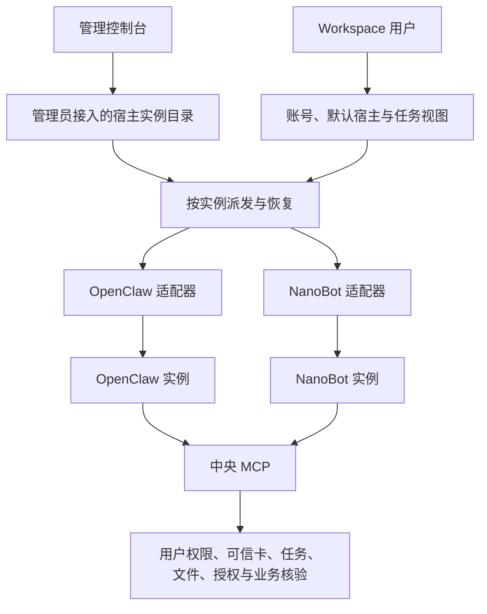

# 工作台并列智能体宿主与默认实例设计

定稿日期为 2026 年 11 月 23 日。本文作为 Workspace 多宿主实现与测试的设计基线。首个新增宿主选用 HKUDS NanoBot，以现有 OpenClaw 的业务体验为对照。Pi 沿用相同的接入位置，待首个独立宿主完成验证后再实施。实施进度见[试点验收记录](../验收记录/工作台并列宿主与纳米机器人试点-2026-11-23.md)。生产试点按用户确认的范围向现有两个 Workspace 账号开放选择，沿用各自已有的业务权限。

管理员接入实例，普通用户从对本人开放的实例中选择默认值。**默认宿主决定下一项新工作交给谁，已开始的工作按原实例续办。** 例如，用户上午在 OpenClaw 发起审批，下午将默认宿主改为 NanoBot。新的待办查询发给 NanoBot，上午的审批卡仍指向原 OpenClaw 任务。

## 一、交付目标与现有基础

完整交付以独立运行验收为准。在隔离环境停用 OpenClaw 后，只开放 NanoBot 的两个测试账号能够独立开通 Workspace，并以各自的权限完成查询、登录续办、受控写入、文件交付、消息端接续和重启恢复。反向停用 NanoBot 时，原属 OpenClaw 的任务也能继续办理。

中央服务已有按用户签发的 MCP 凭据、工具权限、可信卡、业务操作账本、任务和协调租约。Reference Host 曾以两个真实身份通过公开 MCP 读取会话状态，其中一个身份完成 OA 待办查询，并验证同实例重启。该轮为只读证据。实施基线 `49ca538` 的 Workspace 只构造一个 OpenClaw Gateway，账号保存一个 OpenClaw 会话键，入队时也固定写入 OpenClaw。二期的工作集中于实例选择、可靠派发和 NanoBot 适配。[一期宿主设计](./宿主无关化与标准远程协议接入一期详细设计.md) · [参考宿主验收](../验收记录/宿主无关化一期自动验收-2026-08-29.md) · [启动装配](../../agentbridge/cli/main.py) · [账号与派发存储](../../agentbridge/workspace/stores.py)

## 二、管理员与用户的操作

管理员配置稳定实例 ID、显示名、类型、受控连接和开放用户范围，可测试连接、启用实例、停止接单和撤权。管理台分别显示适配器版本、已核准能力、带时间的健康信息和活动任务。曾登记或曾上报健康的实例，仍需验证当前的 Workspace 派发路径。

普通用户在账号设置中选择实例，输入区显示当前宿主。设置页只投影本人可选的实例、状态和已验收的能力。连接地址和部署凭据由管理员维护。

| 场景 | 工作台行为 |
| --- | --- |
| 首次使用 | 迁移已有账号时沿用原 OpenClaw 实例、端点和会话。新账号只有一个可用实例时自动选中，有多个时由用户选择，没有时提示联系管理员。仅开放 NanoBot 的用户可独立完成身份确认和账号激活。 |
| 保存默认宿主 | 设置按账号跨设备保存。界面说明新消息投向哪个实例，进行中的任务继续由原实例办理。用户切回某个实例时可接上本人在该实例的会话。 |
| 历史与续办 | 任务总览按本人主体汇总并标注来源实例；聊天历史及送给模型的上下文按实例和会话隔离。任务卡上的继续、取消、附件和授权操作都解析至原任务。如果“继续刚才那个”匹配多个任务，由用户选定。 |
| 双标签页 | 服务端根据设置版本检查新请求。如果另一个标签页已改默认值，旧页显示新目标，用户确认后再发送。重试已发送消息时直接找回原派发。 |
| 实例离线或停用 | 短时离线显示等待、待核对或明确失败。管理员停止新接单时，允许原任务在既有授权范围内收尾。安全撤权立即阻止后续受保护操作。用户可为新工作另选实例，历史保留原归属。 |

## 三、架构与职责

**Workspace 到宿主**负责就绪检查、接单、事件订阅、取消和原运行核对。**宿主到中央 MCP**负责以当前用户身份调用获准工具，按宿主与版本核准的等级处理结果。两条连接分别建立证据。中央服务继续掌握下游身份、会话、权限裁剪和业务终态；适配器负责把消息、私有交互和结果送到正确的会话及端点。[现有 L1/L2/L3 契约](../../agentbridge/core/host_contract.py) · [多端任务接续设计](./多端智能体任务接续设计.md)

## 四、实例、身份与请求归属

当前实例在界面显示为“NanoBot”，宿主类型为 NanoBot，稳定实例 ID 为 `nanobot-office`。每个账号单独绑定端点和会话。同类型可以部署多个实例。重命名实例、修改默认值和重启进程均保留历史记录中的实例 ID。

| 数据或接口 | 实现约定 |
| --- | --- |
| 实例目录 | 保存稳定 ID、类型、显示名、受控连接配置引用、启停状态、开放范围和适配器版本。复用兼容登记与运行观测；展示时分别判断版本核准、连接就绪、用户已绑定。 |
| 默认设置 | 按账号保存默认实例 ID 和设置版本。用户从当前登录会话确定；列出可用实例、保存设置和首次派发时均在服务端校验开放范围。 |
| 用户与实例绑定 | 以账号和实例区分端点、会话、中央主体及个人凭据引用，复用中央端点及主体校验。渠道配对只确认入口访问资格，业务权限由中央用户身份决定。 |
| 派发 | 原子固定原始请求键、用户、实例、会话、端点、内容摘要及附件引用，持久保存受理状态和宿主运行标识。从任务卡续办时按原任务解析实例。 |
| 任务与操作 | 复用 Task、Operation、Interaction、Artifact 和协调 Lease。任务与原派发和实例可相互追溯。单个任务只有一个有效协调者；展示卡片的另一端点可以让用户操作，由原协调者续办。 |

**重试先找原请求，再读默认值。** 当前网页消息按用户和请求键去重，派发表的唯一约束还包含宿主。实现时应在同一数据库事务中按“用户＋原始请求键”认领首次发送。已有请求的内容和附件一致时返回原派发；同键载荷不同则报告冲突。首次发送才读取当前默认值并固定目标。已有请求的查询或续办仍校验本人的现行访问权限。用跨宿主切换、重复点击、并发标签页和重启重试验证只有一项派发及一次预期业务调用。[消息与派发事务](../../agentbridge/workspace/stores.py) · [工作台可靠投递设计](./工作台请求受理前可靠投递详细设计.md)

## 五、NanoBot 适配

首轮试点固定 `nanobot-ai==0.4.2`，安装到独立宿主环境。适配器通过 NanoBot Python SDK 驱动运行。该版本提供流式事件、取消和会话历史，已移除旧的独立 `nanobot serve` 接口。按用户选择 MCP 客户端和工具目录；NanoBot 会话键用于区分会话历史，业务凭据按已验证主体选取。[固定版本 SDK](https://github.com/HKUDS/nanobot/blob/v0.4.2/docs/python-sdk.md) · [版本迁移说明](https://github.com/HKUDS/nanobot/blob/v0.4.2/docs/updating.md)

中央按适配器版本登记能力。NanoBot 适配器 `0.2.0` 已登记 L2；`0.3.0` 在配置独立协调进程后可协商 L3，底层 SDK 固定 `nanobot-ai==0.4.2`。未登记的新版本按 L1 协商。复验 0.3.0 时，使用项目验证解释器运行 `scripts/run_nanobot_conformance.py --nanobot-python <独立 SDK 解释器> --output <收据文件>`。该入口按共享向量核对 29 个场景，逐项关联可重跑的隔离探针。[中央兼容登记](../../agentbridge/core/host_contract.py) · [NanoBot 专项门禁](../../scripts/run_nanobot_conformance.py) · [试点验收记录](../验收记录/工作台并列宿主与纳米机器人试点-2026-11-23.md)

### 接单、断线与恢复

适配器提供就绪检查、按请求键接单、订阅事件、查询原运行和取消原运行。宿主侧在可能产生业务活动前持久记录接单与关联信息。网页订阅 Workspace 的事件，后台适配器持续消费 SDK 运行流。SDK 提前结束事件迭代可能取消运行，因此浏览器刷新只结束网页订阅，用户显式停止才取消原运行。已经过提交边界的业务仍以中央权威回读为准。

回执丢失时，原适配器按已固定请求键和会话查询原运行，结合 Task、Operation 判断结果。已受理就继续观察；无法核实时显示“结果待核对”。原任务不会因为超时而转投另一实例。首批试验需专门验证进程重启后的关联和核对能力；SDK 能重读聊天历史本身不足以证明某次业务操作的终态。

每个已打开的 Workspace 页面固定读取该页所选实例。对话、任务计数、任务列表、文件卡、活动请求和实时更新使用相同范围。另一页修改默认宿主后，先前页面仍可阅读原内容；发送新消息须重新确认最新选择，草稿保留。显式续办仍检查原任务、原实例及该主体当前绑定。NanoBot 的会话状态查询不建工作台任务。创建了任务的只读查询按中央回执确认结果，遇到交互、提交或待核对状态时继续原协调流程。

### 可信交互和受控写入

NanoBot 标准 MCP 包装器主要呈现 `result.content`。AgentBridge 把完整的交互放在工具结果顶层的私有 `_meta` 中。适配器应在标准包装器转换前取得原始结果，按两条路径交付：

1. 模型只收到清洗后的公开文本、结构化状态和非敏感引用。
2. 中央生成的登录、填表、执行授权卡只交付给该主体已绑定的私有端点。宿主仅持久保存恢复所需引用。密码、已填字段及短期可信链接不得进入模型、聊天历史、普通日志或测试报告。
3. 用户完成卡片后，原协调者核对状态并在原任务上续办一次。多端点击、重复或晚到的通知均受中央单次消费与租约约束。业务写入继续走 `prepare → authorize → commit → verify`。

验收时给合成卡设置可辨认的公开字段和私有标记，检查工具调用后的下一次模型请求。公开字段应到达模型，私有标记只到已绑定端点；同时检查两名用户的聊天历史、长期记忆、文件与普通日志。若标准扩展点无法无损取得原始结果，试验适配器自有的受控 MCP 工具封装，再验证上面三项。只通过只读查询的版本仅展示已验收的只读能力。[NanoBot 工具结果转换](https://github.com/HKUDS/nanobot/blob/v0.4.2/nanobot/agent/tools/mcp.py) · [中央交互隐私约定](../平台能力/远程模型上下文协议接入.md) · [受控写入模型](./受控写入模型.md)

### 消息渠道、技能与能力对照

中央仅向原实例内、具备相应推送能力的端点投递聊天镜像和任务通知，领取已有待发记录及发送前均复核归属。OpenClaw 网页对话继续同步至该账号原 OpenClaw Telegram 私聊。NanoBot 的普通聊天在已核验的本人 Workspace 和同一 NanoBot Bot 私聊之间双向展示。网页提问及公开答复进入个人私聊，私聊提问及确认送达的公开答复进入该实例网页时间线。每个问题只由发起端运行一次模型；历史不回补，登录、配对、授权、私有卡和文件沿专用流程处理。任务终态仍由原私聊独立接收。

首个消息渠道选 Telegram，试点使用独立测试 Bot。绑定时核验机器人实例、Telegram 数字用户 ID 和私聊端点。普通聊天消息或按钮点击不替代中央执行授权。完整纵切包括在 Telegram 发起、在 Workspace 授权、由原协调者续办、结果回到获准端点。本轮优先交付 Workspace 和 Telegram，微信接入与对应渠道验收延期。本机 OpenClaw 2026.7.1 的消息观察钩子无法截断投递，私聊的插件绑定失效时可能回到 OpenClaw 处理。共用 Bot 需要具有持久记录、明确所有权和故障时拒绝转发的单一收件入口。试点 Bot 使用独立凭据、更新游标和入站账本，两条收件路径分别运行。[NanoBot Telegram 渠道](https://github.com/HKUDS/nanobot/blob/v0.4.2/docs/guides/telegram-ai-agent.md) · [多用户身份路由](./智能体宿主多用户身份路由.md)

| 与 OpenClaw 对照的能力 | 测试所需的可观察结果 |
| --- | --- |
| OA、数据库、语雀、照明查询 | 两名权限不同的用户仅能取得获准工具及本人的数据。空结果、多结果、长文本、权限不足、超时和会话过期都有准确反馈。 |
| 可信办理与批量任务 | 登录后回到原请求。字段卡、执行授权、逐项进度、连续新卡与权威回读关联同一任务；过期授权不能消费，结果未知的写入不重放。 |
| 快捷操作、文件与通知 | OA 快捷查询和结果选择能追溯到正确实例与端点；上传、交付、到期展示和获准的重新生成均核验主体。后台终态只送达获准端点。 |
| 业务技能 | 验证技能发现、账号绑定、试用、实际加载、逐次工具调用限制、反馈和评测。对照 OpenClaw 钩子验证越出技能范围的调用被拒绝。[现有宿主钩子](../../integrations/openclaw-agentbridge/lib/plugin.js) |
| 运行治理 | 管理员能从任务查到实例、版本、受理状态、操作和恢复记录，并区分模型回答结束、宿主运行结束与业务操作终态。 |

## 六、仓库改动范围

| 模块 | 实施时核对的范围 |
| --- | --- |
| [管理控制台](../../agentbridge/admin/)与[宿主契约](../../agentbridge/core/host_contract.py) | 管理员实例目录、连接测试、开放范围、启停和审计。沿用兼容登记、能力核准与协调 Lease。 |
| [Workspace 存储](../../agentbridge/workspace/stores.py) | 默认设置、每账号每实例绑定、跨默认值变更的请求去重。迁移时保留原 OpenClaw 端点、会话、旧派发和授权归属。 |
| [启动装配](../../agentbridge/cli/main.py)、[Workspace 应用](../../agentbridge/workspace/application.py)与[Gateway](../../agentbridge/workspace/gateway.py) | 将实例选择收敛到派发边界，发送、取消、历史核对、恢复和唤醒均从原派发或任务取得适配器。 |
| [Workspace 接口](../../agentbridge/workspace/server.py)与[界面](../../agentbridge/workspace/static/) | 增加本人可用实例列表和保存默认值入口，在输入区和历史中标明宿主。历史、SSE、文件及任务操作持续校验主体、实例绑定与端点。 |
| [中央服务](../../agentbridge/core/central_service.py)、[快捷查询](../../agentbridge/core/quick_queries.py)、[结果选择](../../agentbridge/core/actionable_results.py)与[凭据状态](../../agentbridge/workspace/credential_health.py) | 清点绕过普通派发或直接筛选 OpenClaw 的路径，特别是账号激活、端点登记、OA 待办选择、技能试用、任务唤醒与凭据提示。按原归属或已验收能力处理。 |
| 拟新增的 `integrations/nanobot-agentbridge` | 封装 SDK、受理记录、持续事件消费、用户凭据选择、私有交互、渠道投递和运行上报。生产下游访问仍由中央受控会话执行。 |

### 试点部署和绑定

中央服务继续部署在 Linux。NanoBot 在原有受管 Mac 上运行独立进程，使用自己的运行目录、模型登录、私聊 Bot、账本和回环端口。Linux 访问模型授权端点的预检得到地区拒绝；实际官方模型授权与推理已在受管 Mac 直接验证。中央通过单独的受管连接投递到该实例。模型账号由 NanoBot 独立持有，每个业务主体使用自己的中央凭据、SDK 会话和工作目录。图片按请求校验并临时提供给 SDK，模型完成后清理宿主图片副本，后续读取仍沿用中央附件的主体与时效检查。

两个现有账号均可选择试点实例。已有可核验 Telegram 私聊的账号沿用数字身份映射。第二个现有账号只通过 Workspace 使用试点实例。将来用户自行接入 Telegram 时，可从本人 Workspace 的“端点”页进入试点 Bot，在该私聊取得确认码，回到工作台确认。挑战绑定所选实例、Bot 与登录主体，过期、新生成和解除关联都使旧挑战失效。投递回执始终核对原私聊和原消息，受理未知或送达未知保留原记录。运维入口见[独立 Telegram Bot 试点](../部署运维/独立电报机器人试点.md)。

新 Workspace 用户也可经试点 Bot 开户。管理员先为已授权中央主体分配数字私聊身份和个人 MCP 凭据。用户从未登录的 Workspace 发起挑战，经管理员分配的本人私聊确认，再于发起挑战的浏览器设定个人登录信息。组聊、转发、其他数字账号及已消费的挑战均不能完成开户。主动解除 Telegram 关联后，本人的 Workspace 登录仍可使用。入口仅显示该账号获配的实例。[零 Workspace 账号的隔离开户验证](../../tests/support/nanobot_enrollment_probe.py)

凭据卡可以在 L2 原端点续办。与任务关联的写入由 L3 协调者取得原任务租约，沿用中央授权和权威回读。验证中用不同的合成下游分别制造成功和回执未知，记录实际写入数。适配器报告可用输入类型，工作台按当前实例显示可用入口。发布后按实际能力、凭据和渠道验收结果分别记录，不将一次模型答复视作业务核验。

## 七、分批实施与验收

| 批次 | 实施与试验 | 通过条件 |
| --- | --- | --- |
| 1. 隔离安装与技术验证 | 使用独立环境安装固定版本，以两个合成身份跑通测试派发、真实 SDK、中央远程 MCP 及流式响应。用合成可信卡检验私有结果分离。注入网页断开、受理回执丢失和适配器重启。 | 可指出请求由谁受理、工具以谁的身份执行、私有卡在哪里分离。能找回原运行或明确标记待核对，记录业务调用次数，证明未重复执行。分别标记真实组件、模拟模型和合成下游。 |
| 2. Workspace 并列派发 | 管理员接入 OpenClaw 和 NanoBot。双账号设不同默认，验证新账号单宿主激活、旧账号迁移、跨设备保存、双标签并发、切换后重试和旧任务续办。 | 停一实例时另一实例能独立服务；界面显示的实例与实际派发一致；跨用户、未开放实例被拒绝；一条请求仅产生一次派发。 |
| 3. 可信业务闭环 | 完成“查待办 → 登录 → 原查询继续”、填表、授权、受控写后核验和批量任务。覆盖过期、重复点击、跨端竞争、回执丢失与重启。 | 卡片只到本人；一次授权只消费一次；业务结果可权威核验，未知结果停止执行。真实下游写入另按具体事项获得授权。 |
| 4. 渠道、技能与现有体验 | 在 Telegram 和 Workspace 间验证身份、卡片、文件、通知和接续。对同一业务题比较两个宿主的权限、业务事实、操作状态、调用次数与副作用，并逐项核对上节技能及快捷操作。 | 每项现有能力均能查到验收结论和证据。未通过的能力继续标为待验，界面仅展示已核准的能力范围。 |
| 5. 灰度与独立运行 | 先向试点账号开放，完成失联、撤权、停止接单、重启、回退及两个宿主互相独立运行演练。恢复过程中保留旧实例的请求归属和账本。 | 通过第一节的完整交付判据、项目发布门禁及上线后受影响真实页面复验，方可扩大开放范围。 |

每批开始时在任务记录中引用本文，列明本批场景、版本与候选。完成后将实际结果、起止时间、脱敏证据、未测边界及下一批依赖记入验收记录。复用原有宿主契约向量作为回归基线，同时单独记录 NanoBot 的实际 SDK、真实渠道及经授权的业务证据。设计中的“通过条件”不能直接充作通过记录。[开发验证与发布流程](../部署运维/开发验证与发布流程.md) · [开发安全策略](../部署运维/开发安全策略.md) · [宿主契约测试向量](../../schemas/agent-host/v1/test-vectors.json)
